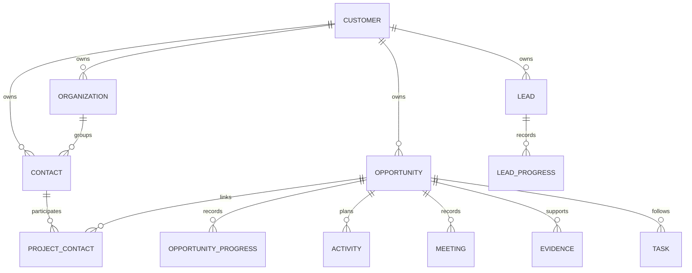

# CRM样例关联升级与项目画像逐项追问

更新日期：2026-10-27。样例版本：2026.10.27-v2-linked。

## 本次发现的问题

检查 Gulf Industry 最新客户级对话后发现，原始样例复用了不同客户的联系人姓名，两个独立商机的配置及事件高度重复；联系人部门映射存在错误；合同阶段和粗粒度证据标记容易被理解成已签合同。客户级查询也缺少明确的项目筛选方式。

历史回答保留原文。新的模型上下文明确以最新CRM记录为准，不能把旧助手说法作为新事实，也不能用阶段或布尔标记推断正式获批、签署或到账。

## 关联模型

联系人属于客户，可以参与同一客户的多个项目；通过独立的项目联系人关系明确其职责。进展、商务活动、会议、证据、任务均记录 customerId、entityType、entityId。线索仅为S0，商机为S1–S8；转换后保留线索及原进展。

查询项目只返回对应项目进展和已关联联系人。客户级查询支持 projectId，不能跨客户筛选。数据库写入校验项目归属、实体类型、联系人部门及参与人归属，创建商务活动时也检查参与人。

## 更新范围和实际结果

- 12个客户，72名独立具名联系人，60个组织部门。
- 24个商机、14条线索，158条项目联系人关系。
- 299条商机进展、66条线索进展，按真实发生时间排序。
- 72条商务活动、48条会议记录、192条证据及24条外部资讯样例。
- 当前数据库共1135条CRM记录，其中待办94条，包含保留的用户创建记录。干净数据库的默认样例为1113条。
- 所有样例均为虚构验证数据，不代表真实客户、融资、审批或政府文件。

每个商机有独立场址、配置、预算假设和分阶段进展，明确哪些是客户陈述、已有记录或内部计划。S5为合同磋商阶段，不自动标记已签署。后续阶段的资金、接入、付款条件也独立管理。

Gulf Industry 的 OP-008 对应 Dubai Jebel Ali，OP-020 对应 Abu Dhabi Mussafah；活动参与人采用本客户的 Fatima、Omar、Aisha、Khalid、Noor、Hassan，并保留完整姓名和联系人ID。不能沿用Northstar的Sarah和David。

## 首次项目对话

1. 客户级对话先列出该客户的项目，要求用户选定；选定后在该会话保留关注项目，用户可明确切换。
2. 首次进入具体项目，说明“首次使用这个项目的画像功能”，列出阶段核对清单。
3. 第一项确认CRM阶段是否准确。销售报告的阶段进入画像，不自动修改CRM正式阶段。
4. 每轮重点追问一个维度，可以包含该事项的状态、依据、责任人和下一节点，避免同时盘问全部清单。
5. 回答保存原话、来源、日期和版本；下一轮参考最新画像，优先询问缺失项。
6. 用户可说“先别问，直接分析”暂停画像引导；不因资料缺失拒绝回答销售主问题。

## 各阶段默认核对项

- S0：阶段、应用需求、客户角色、下一联系节点。
- S1：阶段、技术与应用、场地权利、审批适用性、并网路径、资金路径、决策角色、时间计划。
- S2：阶段、技术与应用、资金、场地、审批、并网、收益依据、决策角色、采购、时间计划。
- S3：阶段、技术边界、并网、资金、决策、采购、时间计划。
- S4：阶段、采购评审、技术偏差、合同、决策、时间计划。
- S5：阶段、签署及生效条件、付款、交付前提、时间计划。
- S6：阶段、交付、技术接口、计划、付款。
- S7：阶段、验收、交付未决项、付款。
- S8：阶段、付款条件与到账、验收、资源支持。

工商业项目优先询问现有厂区使用及安装授权，不能套用新建电站土地问题；渠道项目先核实终端客户、终端项目和伙伴职责。

审批和融资必须区分未核实、已申请、受理、研究中、附条件批准、正式批准、签署和实际到账。早期阶段要求明确路径及下一行动，不要求所有最终许可已完成。已有CRM样例仅作为待确认参考，不能冒充销售本轮确认。

短回答的含义绑定到该用户发言之前的问题快照，避免异步记忆提取把“是的”误绑到下一项问题。涉及其他项目的原话不能写入当前项目。画像按用户及项目隔离，管理员只按既有权限查看。

## 升级与恢复

执行 `npx tsx scripts/upgrade-mock-fixtures.ts` 会先使用SQLite一致性备份，再运行幂等增量升级。替换前的样例记录保存于 mock_fixture_archive 文档集合；不清空对话、画像、用户上传和用户创建记录。不要使用场景重置代替升级。

本次备份位于 `runtime/backups/app-before-linked-2026-10-27T14-23-13-865Z.sqlite`。升级后1135条记录的关联检查无异常。相关实现：mock-fixtures-v2.ts、project-interview.ts、crm.ts、agent.ts、project-portrait.ts、memory-v3.ts。

历史自由文本中的旧姓名及旧助手错误不批量改写。模型使用新记录回答；历史文本只作为对话历史，不能替代最新来源。
