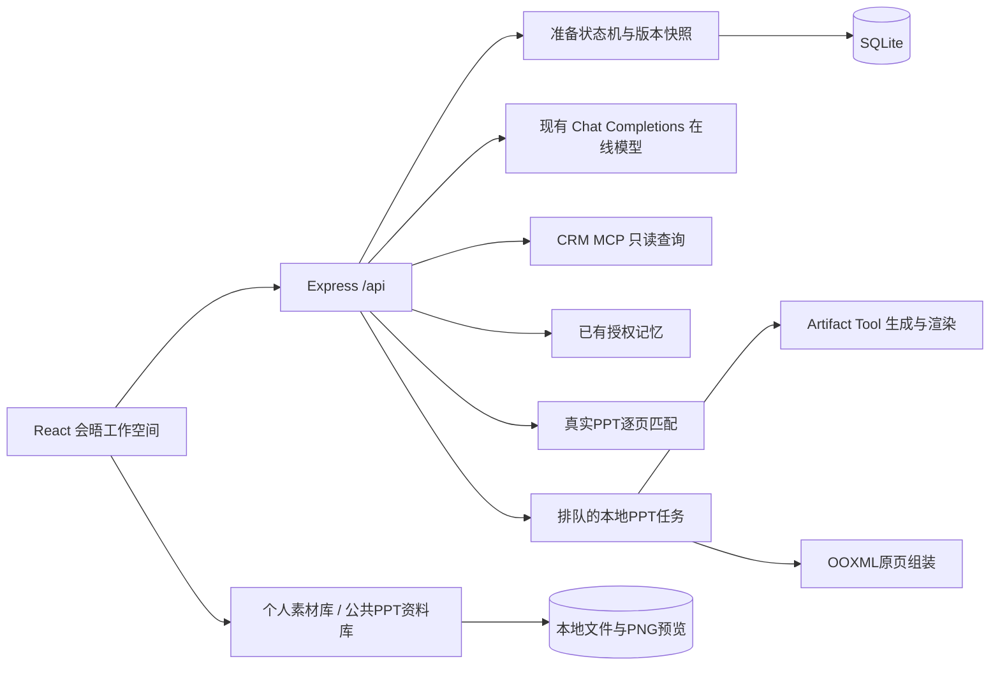

# P11 关键会晤赋能：实施架构与开发明细

版本：v2.0；日期：2026-10-26。承接《P11-关键会晤赋能-开发规划.md》v1.1及Pencil P11原型。本文件描述本次已实现的本地验证版本，后续迭代以此为准。

## 1. 产品目标与边界

销售通过对话说明一次客户交流的背景，Agent帮助确定交流目标、大纲及逐页要回答的问题；销售确认后，系统从公共PPT知识库及本人素材中推荐真实原始Slide。销售可以复用原页、主动生成一页、基于原页改写，或明确留空。最终下载可编辑PPT，所有成功生成的草稿和导出版本进入个人素材库。

本模块覆盖售前、产品、售中、售后、通用材料，不把战略参谋的内部谈判建议直接放进客户演示文稿。现有销售活动指引继续用于项目策略推理；PPT资料库是另一类知识资产，两者并存。

本次交付保留本地Mock CRM和已有在线模型配置，使用真实文件和真实MCP。固定回复仅在显式开启且使用隔离数据库的自动测试中运行。没有新增PPT审批、审核或发布流程。

## 2. 已实现的用户旅程

### 2.1 从客户、项目或原有对话进入

- 首页和左侧导航新增“关键会晤赋能”。
- 在会晤首页搜索客户、线索、商机，按全部/客户/项目筛选，选择后新建准备。
- 可以不关联CRM对象，直接准备通用会晤材料。
- 战略参谋对话提供“准备会晤资料”，沿用当前客户/项目与来源回答。
- 最近准备记录按更新时间排序；标题、所属客户、所属项目、时间、阶段上下排列。
- 每名用户只可恢复自己的准备记录，业务对象同时校验CRM授权。

### 2.2 多轮交流背景

输入会晤目的、参会角色、关注事项、时间、语言、约束等。Agent结合可访问的CRM记录、用户记忆与本次对话追问，并在同一次模型输出内返回回复、背景摘要和建议问题。

建议问题点击后填入输入框，由销售确认发送。完成背景识别后显示“完成背景交流，进入大纲”；也允许销售在已描述背景后直接进入大纲。右侧持续展示背景摘要，支持手动选择中文/英文和交流时长。

### 2.3 先确认大纲，再讨论页数

Agent输出章节标题与目的，用户可以编辑、增加、删除、上移。确认后才生成页数与逐页计划，避免一开始就生成整套PPT。

每个目标页包括标题、章节、内容方向、本页要解决的问题、建议讲述时长、是否属于客户定制页、对应用户原话ID。问题来自本次销售对话，可直接修改。逐页计划支持增删、排序、编辑，确认后才进入素材匹配。

### 2.4 匹配真实原页

候选卡显示原PPT名称、版本、真实页码、标题、缩略图、匹配理由和差异。不同语言或不适合直接复制的素材提示改写，不冒充原页复用。

客户特定背景页没有对应原始材料时明确显示“未匹配”；不会因为有相关知识文章就制造一个原PPT页。用户主动选择：

1. 使用候选原页，保留原生文本、布局和资源。
2. 基于原页改写，进入单页生成。
3. 从个人素材库选择指定文件和页码作为本页参考。
4. 上传PPTX/PDF/DOCX/PNG/JPG作为个人参考资料。
5. 生成本页；成功后先成为草稿，用户确认才采用。
6. 明确留空，保留可编辑标题占位；导出时再次明确确认。

资料选择按目标页保存，切换目标页不会把上一页的参考材料自动套到所有页。

### 2.5 单页生成与整套导出

生成区域左侧为本页方向、补充说明，左下角提供上传与个人素材库；右侧展示真实生成PPT的缩略图。模型只负责结构化文字，服务器按原生PPT文本与图片对象写文件。

生成成功的草稿自动入个人素材库，即使尚未在本次准备中采用也可找回。导出前每页必须已确认原页、确认AI页或明确留空。系统按用户页序组装，下载PPTX；内部来源说明另行下载，不默认插入客户正文。

相同已确认内容重复导出复用已有版本；页面内容变化后生成新版本。历史导出保持不变。流程步骤可返回背景、大纲及逐页计划编辑，内容变化后重新确认受影响部分。

## 3. 系统结构



浏览器不接触模型密钥；沿用管理员设置中的服务地址、模型名和密钥。模型不可用、JSON不符合约定、文件渲染失败都会返回错误，不在正式模式静默替换成固定内容。

## 4. 代码与责任分配

- `apps/web/src/MeetingWorkspace.tsx`：首页、背景对话、大纲、逐页计划、候选、生成、预览导出、个人/公共素材库。
- `apps/web/src/meetings.css`：P11布局、独立滚动、素材面板与响应式样式。
- `apps/server/src/meetings.ts`：状态机、版本校验、模型结构化输出、MCP上下文、用户确认、任务及导出。
- `apps/server/src/materials.ts`：公共种子、个人上传、解析、权限、逐页候选、生成文件归档。
- `apps/server/src/meeting-routes.ts`：受保护HTTP、上传、下载、缩略图、事件接口。
- `apps/server/src/presentation-engine.ts`：PPT检查、原生文本/图片生成、PPT导入渲染、原页组装。
- `apps/server/src/presentation-jobs.ts`、`presentation-worker.ts`：文件任务队列和独立进程，超时与产物完成校验。
- `knowledge/presentations/catalog.ts`：24类标准目录、6个公开来源、10套Mock主题。
- `scripts/build-p11-library.ts`：可重跑的PPT素材构建和检查。
- `tests/meetings.test.ts`、`tests/e2e/meetings.spec.ts`：业务、权限、文件及浏览器旅程验证。

## 5. 数据模型与文件组织

沿用既有SQLite文档存储，不新增独立外部数据库。主要集合：

- `meeting_kits`：userId、scope、背景、消息、章节、目标页、确认标记、当前步骤、runningJob、导出引用、revision及时间。
- `meeting_versions`：每次变更前的准备快照，便于后续审计及扩展回滚。
- `materials`：所属用户或公共标识、资料来源、格式、文件路径、版本、处理状态、Mock标识、关联业务对象、逐页文本、页码、可直接复用标识、预览路径。
- `presentation_jobs`：所属用户、准备、类型、执行状态、错误、预期版本、完成时间。
- `meeting_exports`：所属用户、准备、页序、来源、内容指纹、PPT路径、预览目录及时间。
- 事件记录沿用既有event存储；提供任务查询及SSE事件接口。

主要文件位置：

```text
knowledge/presentations/
  catalog.ts
  research-sources.json
  library/
    manifest.json
    PRE-01.pptx ... GEN-01.pptx
    previews/<资料ID>/<页码>.png
data/materials/
  uploads/       本人上传文件
  generated/     单页生成结果
  exports/       整套PPT与内部sources.md
  jobs/          任务输入、完成回执及必要诊断
```

实际素材根目录默认在数据库同级的`materials`目录。测试数据库使用隔离目录，对应素材也隔离，避免污染主环境。

## 6. 状态、确认与并发

准备阶段：背景 → 待确认大纲 → 逐页计划 → 素材匹配 → 预览 → 已导出。

目标页状态：待匹配、有候选、未匹配、原页已确认、生成草稿待确认、AI页已确认、明确留空、待复核。

所有修改带revision。过期版本返回409，旧任务不能覆盖新内容。同一准备一次仅一个运行任务。返回页计划后，只修改某一页会清理该页的旧选择并标为待复核；未修改页保持原选择。修改背景/大纲需要重新确认相应下游内容。

任务支持取消；取消后不采纳异步结果。原生渲染进程可能仍需结束当前文件操作，取消不承诺立即停止操作系统子进程。刷新页面可以恢复当前任务轮询；服务重启将遗留任务明确标为中断，用户可重试原操作。

## 7. 模型调用与检索

背景对话每轮一次模型输出，包含回复、摘要与建议问题。大纲、逐页计划、用户主动生成单页分别是独立任务，便于用户逐步确认、控制成本。

CRM上下文通过已有MCP客户端按当前用户身份读取。模型只能看到本次任务所需的授权对象摘要、联系人、进展、活动、记忆及相关内部知识，不从用户输入接受任意文件系统路径。

本地候选检索目前使用页标题、提取文本、主题关键字、业务模式、语言及用户可访问范围排序，是可验证的规则检索；尚未实现向量数据库或LLM候选重排。每个候选都必须对应数据库中真实存在的文件和页码。SQLite同时保留逐页全文索引，后续可替换排序模块而保持UI和状态机不变。

## 8. 文件处理与原页保真

原规划中的PptxGenJS/LibreOffice技术选项在实现中调整为Artifact Tool生成、导入与PNG渲染，原页组装使用OOXML原生部件复制。没有将原Slide转为整页截图再导出。

- 默认16:9；复杂OLE、音视频、动画、SmartArt、外链、隐藏页及非16:9原页不承诺直接复用，标记需重新布局或改写。
- 复制Slide及依赖的版式、母版、主题、图片、图表等关系，重写路径与内容类型。
- 客户版导出不携带原文档的演讲者备注与评论；内部资料来源单独留存。
- 支持PPTX、PDF、DOCX文字提取，图片可作为生成页参考图片；本版不提供OCR。
- 上传上限60MB；PPTX限制1–150页，单次目标计划与导出最多40页。
- 文件包校验压缩/解压大小及路径，文件读取仅限服务器记录，下载和预览逐次校验用户与CRM范围。

独立文件进程避免渲染器退出影响HTTP服务。本机Windows渲染器偶有在完成输出后退出异常的情况：只有存在完整成功回执、有效文件和全部PNG时才接受结果，并保存异常码诊断；没有完整回执或缺页仍失败。

## 9. 权限与运行限制

个人素材、生成草稿、导出与准备记录仅属于本人，管理员也不能通过普通资料接口读取其他人的个人文件。公共PPT对具有使用权限的账号开放；公共上传接口仅管理员可用。CRM关联素材同时遵循CRM权限。

本版本是单机验证产品：Mock账号切换不等于生产认证，本地串行文件队列不等于分布式任务系统。正式部署需另行接入企业身份、对象存储、持久化任务队列、容量治理和企业正式产品资料。

## 10. 开发拆解与验收顺序

1. 固化原型验收：确认入口、五段流程、个人素材库、无审核，以及逐页确认规则。
2. 定义实体：准备、章节、目标页、源文件/源页、个人资料、任务、版本及导出。
3. 建库：24类目录，研究来源记录，10套真实可编辑示例PPT，80页实际缩略图。
4. 建立文件链路：上传、格式/包检查、解析、逐页预览、授权下载。
5. 实现背景Agent：CRM/MCP及记忆上下文、结构化摘要、多轮追问与直接进入大纲。
6. 实现逐级规划：大纲编辑确认、页计划编辑确认、版本校验与单页失效。
7. 实现原页候选：可追溯页码、版本、差异和明确未匹配，不自动生成填洞。
8. 实现生成与组装：本页参考选择、主动单页生成、草稿确认、原页合并、空白确认和下载。
9. 实现归档恢复：个人库自动入库、最近准备、任务刷新恢复、取消/失败可重试。
10. 验证与文档：隔离单元/HTTP测试、浏览器真实旅程、文件结构与视觉检查、真实在线模型烟雾验证。

本次已经完成上述实现；具体测试结果及已知边界见《P11-实施与验收报告.md》。公开资料和每套Mock PPT说明见《P11-储能资料研究与MockPPT说明.md》。
