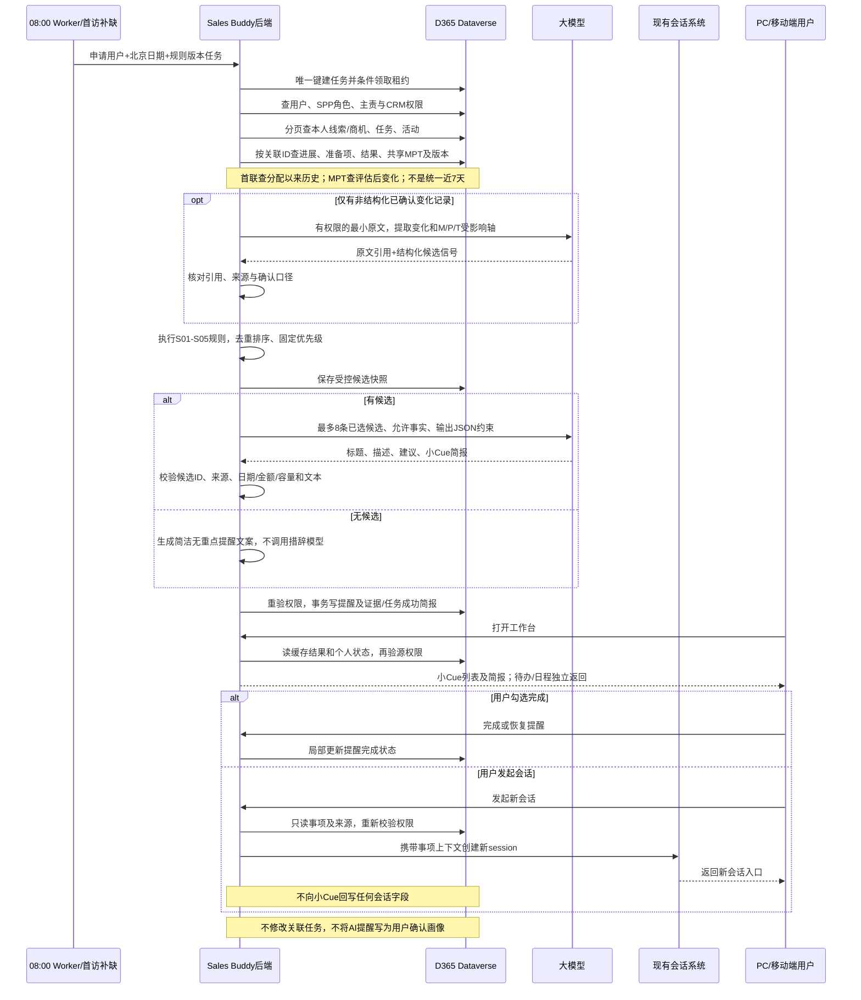

# 工作台 · 小Cue：D365实施与角色场景取数方案

日期：2026-11-25　版本：V1.2　适用：业务负责人、D365实施伙伴、Sales Buddy产品与研发

## 1. 实施结论与范围

**D365/Dataverse存储权威CRM事实和小Cue业务结果，Sales Buddy负责自研PC/移动端、规则计算、定时任务及大模型编排。先按规则找到有依据的提醒，再让模型整理易懂的标题、描述和推进建议。** 不由模型浏览全库自行决定谁需要被提醒。

本方案参考《赢单领航员知识库-D365实体数据落地与业务准备清单》的组织方式。前提是Dynamics 365 Sales Online + Dataverse；当前本地仍以Mock CRM、SQLite文档集合和自研权限运行，以下为接入设计，并非已完成租户建表或生产集成。

所有**新建自定义实体**统一以 `catl_esspilot_` 开头，自定义业务字段以 `catl_` 开头。已有标准实体account、lead、opportunity、task、systemuser等和原生系统字段保持微软名称。赢单领航员七类知识实体同步改为该前缀，七类知识仍是方法论，不存具体提醒实例。EntitySetName以环境元数据为准，不凭逻辑名直接猜复数。

首版覆盖销售5类、SPP Leader 5类、区域总裁5类场景；没有手动刷新、事件即时增量、逐级升级、自动完成CRM任务、真实邮箱或外部日历。后续增加场景应单独评审规则与数据。

## 2. 功能清单拆解

| 编号 | 功能 | 业务行为与前端 | 后端处理、D365读写与边界 |
|---|---|---|---|
| F01 | 身份及管理范围 | 同一小Cue入口按实际组织身份展示 | 查当前用户、SPP成员角色、Leader及区域总裁映射；业务管理范围与CRM读取权限取交集，管理员身份不自动得到团队汇总 |
| F02 | 每日生成 | 北京时间08:00后自动产生当日内容 | 按用户/日期/规则版本建唯一任务；后台执行，首访只补缺失任务，不提供刷新接口 |
| F03 | 今日简报 | 小Cue形象、标题及描述；“小Cue提醒您，今日需优先……” | 从已验证候选生成简报，无足够事实则明确无重点提醒；不显示虚构客户、任务数量或数据覆盖宣传语 |
| F04 | 提醒列表 | 进行中/已完成两Tab，每页8条；窄高比适配移动端 | 读取提醒内容及个人状态字段；当天优先安排最多8条，不删除仍成立的历史进行中提醒，按页加载 |
| F05 | 详情与信息来源 | 标题、描述、关联客户/线索/商机/商务活动、推进建议 | 每次读取重验源记录权限；保留来源版本与摘录，不展示无权限的旧快照 |
| F06 | 完成与恢复 | 勾选按钮切换完成/进行中 | 只修改Cue用户状态；不关闭关联CRM任务；撤销和恢复持久化 |
| F07 | 个人反馈 | 点赞/点踩互斥、可取消 | 写个人状态，首版不自动改变业务规则或形成团队考核 |
| F08 | 发起AI会话 | 卡片发起会话，启动中防重复 | 读取事项作为上下文创建新session，会话由现有会话系统保存，小Cue不回写会话信息；有明确商机才绑定该商机，团队汇总不绑定列表第一条商机；AI委托带系统来源标识 |
| F09 | 我的待办 | 移动端进入“目标”，支持分组、查看全部、添加、完成/恢复 | 复用CRM task，执行人当前用户，创建前确认；按截止时间分逾期/今日/本周/以后/已完成；不另建个人便签 |
| F10 | 待办辅助 | 快速输入、关联洞察、日报呈现 | 沿用现有捕获/确认及日报逻辑；AI解析为草稿，确认才创建；日报同步失败单独重试，不伪造任务创建失败 |
| F11 | 我的日程 | “目标”下按日期查看商务活动及详情 | 当前口径是本人创建的活动；按北京时间查询，不猜内部参会人、结束时间、可用空档或会议链接；无会前讨论按钮 |
| F12 | 空/失败/生成中 | 待办与日程可独立使用，旧内容保留 | 区分未生成、无候选、生成失败和来源不可访问；失败自动重试，不将失败包装成“暂无提醒” |
| F13 | 运维与质量 | 运维查看任务结果、规则版本和异常 | 记录任务、重试、模型校验失败及来源范围；业务用户不开放手动重新生成 |

PC与移动端共用规则及数据。移动端底部为对话、客户经营、小Cue、目标、工具箱；小Cue首页不再塞入待办与日程，PC沿用当前工作台布局及目标入口。UI验收以当前系统实现及同步原型为准，不恢复已删除的旧功能。

## 3. 组织、角色与数据边界

| 对象 | 业务定义 | 取数规则 |
|---|---|---|
| SPP团队 | 由销售S、项目经理PM、解决方案工程师PD组成的销售团队 | 建有效成员及角色关系；不能把整个团队都认定为销售 |
| 商机主责 | 每个商机对应一个主责销售、一个PM、一个PD | 商机显式关联SPP及三名主责；不要用创建人推断主责，也不要用多团队成员关系猜商机归属 |
| 销售 | 当前用户为销售成员 | 我的主责线索/商机、执行人是我的任务、本人创建的活动，均需有源记录权限 |
| SPP Leader | 管理一个或多个SPP团队 | 按自己管理的SPP汇总，不是读取全部可见CRM记录；PM/PD的有效进展可支持项目事实，但不参与销售频率比较 |
| 区域总裁 | 管理多个SPP团队的Leader | 按所管区域展开SPP，逐团队汇总并可下钻；不读取管理范围之外的信息 |
| PM/PD及其他身份 | 首版不增加个人提醒场景 | 可继续使用已有待办/日程；不能因后台角色为manager/admin就收到团队经营总结 |

用户同时具备多个角色时，当前代码优先区域总裁、再SPP Leader、再销售。首版延续该规则，若需多身份切换应另行确认。

画像输入：团队汇总只使用商机共享的**身份与范围、业务背景、当前MPT定位、S1–S4业务情况**。关键关系与竞争、事实风险未决、我的推进计划、时间线与来源为个人私有部分，不能用于上级汇总。个人画像全私有；客户画像的“我的经营关注”私有。销售个人提醒可按需使用本人获准的画像，不使画像里的AI推断成为已确认CRM事实。

## 4. 统一取数口径

1. 生成时间为T，北京时间08:00任务实际取得的业务快照。相对24小时/7天/28天均相对T；按天统计先转北京时间，存储时间保留UTC。08:00前读取已有有效结果，不提前生成当天任务。
2. 活跃线索排除关闭、取消、已转化；活跃商机限定S1–S4且未赢单、丢单或关闭。商机不扩展S5以后阶段，M/P/T不替代CRM商机阶段。
3. 有效进展须有实际业务内容、事实发生时间、记录人及实体关联，排除草稿、取消、AI自动生成和系统汇总。当前Mock仅用文本至少5字符等粗筛，D365实施需用明确业务字段，不能把字数当真实性证明。
4. 联系、准备、结果、重大变化、管理介入均需显式业务关联；不能因为普通活动标题包含“投标”就推断请求管理层支持。
5. 缺记录只表达“系统中未见记录，请确认”，不判断销售没有工作或客户实际未联系。读取失败或无权限不能计为零记录。
6. 不同场景需不同时间窗：首次联系可能读取线索分配后的完整历史；频率读取56天；MPT复核从最近评估时间起查。不能统一只拉7天数据。

## 5. 销售提醒场景与取数逻辑

| 编号/业务场景 | CRM及画像来源 | 范围与筛选/关联逻辑 | 触发、排除和建议输出 |
|---|---|---|---|
| S01 新线索尚未首次联系 | lead：主责销售、分配时间、状态；线索进展：联系类型、内容、时间；商务活动：关联线索、实际发生及结果 | 当前销售主责且活跃线索；从本次分配时间起关联进展与已实际发生的有效联系活动 | 分配超过24h且未见首次联系依据；排除仅计划未举行活动。标题“联系XX客户，确认XX线索需求”，建议联系及补录。重新分配后的首联口径需业务确认，当前代码会查线索全部历史 |
| S02 关键任务逾期 | task：执行人、优先级、截止时间、状态、关联客户/项目 | 执行人本人，未完成且未取消，P1，dueAt<T；关联客户/项目仍可访问 | “提交XX报价资料：已超过约定截止时间”；写明原截止日期和交付内容，建议交付或重新约定时间。Cue完成不等于任务完成 |
| S03 重要沟通前有明确准备缺口 | 商务活动：创建人、重要性、开始时间、准备任务关联；task：准备项、执行人、状态；共享项目画像 | 本人创建且T<开始时间≤T+24h的重要活动；读取明确关联的未完成准备任务 | 有至少一项未完成准备任务才提醒；标题“XX评审前，补齐报价与技术方案”，点明材料及责任人。不凭画像信息少就推断会前缺口 |
| S04 商务活动结果待确认 | 商务活动：计划/实际发生时间、状态、结果确认、结果正文；关联线索/商机进展或会议结果 | 本人创建且计划时间<T−24h；查活动ID关联的有效结果及进展 | 无结果正文、无确认、无关联有效结果；实际发生未知则“确认XX沟通是否举行并补录结果”，已发生则“补录XX沟通结论与下一步”。取消活动不提醒 |
| S05 关键变化后复核MPT定位 | opportunity；共享MPT：已评估、M/P/T、评估时间和版本；商机进展：已确认重大变化、受影响轴、原文依据 | 本人主责活跃商机，存在已确认MPT；重大变化发生在最近MPT评估后，影响M/P/T至少一轴 | “客户调整采购方式，请复核XX商机P/T定位”；显示变化、评估时间和复核入口。不自动改MPT，不将未知情况变成重大变化 |

准备任务必须关联活动，不等于用户的所有未完成任务。重要活动及P1必须有业务定义或实际字段，不能由模型自由划定优先级。

## 6. SPP Leader提醒场景与取数逻辑

按管理SPP逐团队生成汇总，明细保留客户/商机/责任人及事实来源；重复实体合并，汇总数字仅来自当前可读范围。

| 编号/业务场景 | 数据来源 | 取数与触发逻辑 | 提醒内容与边界 |
|---|---|---|---|
| L01 S级客户缺少跟进记录 | account客户等级、SPP、主责；关联商务活动、线索/商机及其进展 | 所管SPP的有效S级客户；沿客户→线索/商机→进展归并；近7天无有效活动且无有效进展 | 罗列客户名/编号、主责、最近记录日期或“未见记录”；建议确认经营安排。PM/PD真实记录也可证明发生跟进；无记录不等于没联系 |
| L02 重点项目缺少明确推进安排 | 重点标识的S1–S4活跃商机；下一步；关联task；共享画像背景 | 不存在未完成且有执行人/截止时间的任务，同时不存在责任人、日期、具体动作齐备的未完成下一步 | 列商机和缺少的安排，建议由S/PM/PD确定下一步；共享画像只补充背景，不读取下属私人计划 |
| L03 重点项目发生重大变化 | 重点商机、近7天有效商机进展、重大变化确认；共享MPT | 近7天存在人工确认的重大变化；按商机归并变化，展示对推进的事实影响 | 如“XX项目并网日期调整，请确认里程碑影响”；不把所有新增记录、预测修改或普通字段更新时间都算重大变化 |
| L04 重要评审或投标需管理介入 | CRM关联实体上的明确管理请求：状态、原因、所需日期、请求对象/事项 | 管理范围内open请求，T<neededBy≤T+7d；需业务标识为评审/投标管理介入 | 列需要决策或协调的问题、日期、责任方；没有显式请求不推断Leader必须介入。当前Mock只有通用请求，评审/投标分类需补齐 |
| L05 销售推进记录覆盖偏低 | SPP销售成员、有效在手线索/商机、记录人明确的进展和已完成有效活动 | 至少2名有在手项目销售；近28天“存在有效记录的工作日数÷窗口工作日数”；零记录或低于本团队均值 | 列成员、覆盖天数/分母、团队均值，先核实分工/休假/记录完整性。PM/PD不纳入比较；不输出绩效或工作投入结论 |

当前频率实现按周一至周五统计，未对法定节假日、请假、入职、兼职、项目工作量校准；若未接入这些数据，首版必须显式保留该口径说明，不包装为标准考核指标。

## 7. 区域总裁提醒场景与取数逻辑

区域总裁接收自己管理SPP的经营概览，而非所有销售卡片逐条转发；不构成逐级升级机制。

| 编号/业务场景 | 数据来源 | 取数与触发逻辑 | 输出与管理动作 |
|---|---|---|---|
| R01 S级客户经营覆盖缺口 | 区域→SPP→S级客户，以及活动/进展 | 对每个所管SPP执行L01的近7天反关联查询，按团队汇总及客户下钻 | “XX SPP有若干S级客户近期缺少跟进记录”；只展示授权范围内计数和明细，与Leader确认安排 |
| R02 重点项目长期无明确推进 | L02数据、每日缺口观察记录 | 当前仍满足L02，且同一团队/商机的缺口firstSeen持续≥7天，观察检查未超过48h中断；一旦计划补齐关闭观察，复发重新计时 | 标明持续时间、项目和SPP Leader，要求明确处置安排；不是将Leader卡片延时升级 |
| R03 重点项目重大变化 | 所管SPP重点商机近7天已确认重大变化及共享画像 | 同L03，按团队/商机整理；只取已确认事实 | 提示对关键项目及区域经营的已知影响，不自动推算合同金额损失或承诺资源 |
| R04 跨SPP资源或决策请求 | 明确open管理请求、所需日期、跨团队协调标识、关联项目 | T<neededBy≤T+7d且requiresRegionalCoordination=true，属于所管SPP | 直接列跨团队需要协调什么、何时、由谁跟进；未提出请求时不因项目大就自动拉高层介入 |
| R05 团队销售记录覆盖持续偏低 | 与L05相同，增加前一28天记录窗口 | 当前28天和此前28天两个窗口，相同销售都零记录或低于其团队当期平均；每团队至少2名有效销售 | 按SPP列持续差异及口径，请Leader核实；不排名PM/PD、不比较不同团队原始记录数量，不作为绩效评分 |

区域汇总可一张卡含多个对象，但详情及会话须保留每个对象的权限边界。汇总名单变化不应导致同一管理行动重复推送，详见第10章。

## 8. CRM源实体与字段准备清单

下表为业务映射要求，**不是要求重建一套CRM**。合作方已存在的定制表和列优先复用并提交实际逻辑名；只有不存在才扩展。标准字段与拟新增自定义字段分开登记。

| 来源 | 标准/已有对象 | 必须提供的业务字段或关系 | 用途及准备责任 |
|---|---|---|---|
| 用户与组织 | systemuser、team及伙伴现有组织结构 | 有效用户、业务角色S/PM/PD、SPP成员及有效期、Leader、所属区域、区域总裁 | 业务提供组织台账，实施方映射；不能直接以D365安全团队等同业务SPP |
| 客户 | account | 名称/编号、S级等级、SPP归属、主责销售、状态 | S客户无记录规则；确认一个客户跨SPP经营如何去重 |
| 线索 | lead | 名称/编号、客户关联、主责销售、SPP、分配时间、状态 | 首联；owner不一定是业务主责，createdon不等于分配时间 |
| 商机 | opportunity | 名称/编号、客户、SPP、主责S/PM/PD、S1–S4、重点标识、状态、下一步三要素 | 项目汇总；S阶段是伙伴字段/BPF映射，不默认套用微软任意阶段 |
| 任务 | task | 标题/描述、执行人、截止时间、优先级、状态、关联实体、活动准备关系 | 逾期与准备缺口；当前P1需映射标准prioritycode或伙伴自定义枚举 |
| 商务活动 | 伙伴现有活动表或appointment/phonecall等具体活动类型 | 创建人、计划开始、实际发生/完成、状态、重要性、结果/确认、客户及项目关联 | 统一适配为业务活动；activitypointer是聚合读取入口，不假定直接创建任何通用活动 |
| 线索/商机进展 | 伙伴现有定制进展实体 | 关联线索/商机/客户/活动、类型、内容、记录人、实际时间、事实/AI来源、重大变化确认和受影响轴 | 有效联系、结果、覆盖率及变化；标准CRM没有可直接假定的统一“商机进展”表 |
| 项目共享画像/MPT | 赢单领航员既有画像实施范围 | 共享模块1–4、当前M/P/T、是否已评估、评估时间、版本、事实来源 | 复核基准及背景；本方案不重建画像，也不读取下属私人模块 |
| 管理介入请求 | 伙伴现有请求或业务实体扩展 | open/closed、请求原因、所需日期、关联项目、评审/投标类型、跨SPP标识 | L04/R04；不能用普通活动描述替代明确请求 |

若需新建上述来源表，其名称也遵循catl_esspilot_，但应纳入对应CRM/组织/画像专项设计，不在小Cue方案内重复列一批替代CRM表。CRM字段映射形成“实际实体逻辑名、列逻辑名、类型、枚举、关联、空值含义、权限”工作簿，实施前逐项签认。

## 9. 小Cue必要实体与详细字段设计

### 9.1 结论：新增3张表，复用现有CRM与会话

此前6表方案将同一接收人的提醒、状态、来源拆开，日简报与日生成任务也分开，没有必要。首版收敛为以下3张表；这是“业务结果、定时任务和持续观察均落在D365”的最小推荐方案，不是声称任何架构都必须3表。

| 中文表名 | English table name | 实体逻辑名 | 一条记录表示什么 | 必须承担的功能 |
|---|---|---|---|---|
| 小Cue提醒 | Cue Item | catl_esspilot_cue | 一个接收人、一个场景、一个具体行动周期的提醒 | 标题/描述/建议、来源证据、排序、完成/恢复、点赞/点踩；跨日保留稳定身份 |
| 小Cue每日生成 | Cue Daily Run | catl_esspilot_cuegeneration | 一个接收人在一个北京业务日、一个规则版本的生成任务及成功简报 | 防重复生成、任务领取/重试、快照、当日简报、发布结果与故障状态；合并原dailybriefing |
| 小Cue持续观察 | Cue Observation | catl_esspilot_cueobservation | 一个场景、一个SPP、一项商机的事实缺口观察 | 记录首次发现/最后检查/解决时间，计算R02是否持续7天；不随用户完成提醒而清零 |

**移除3张独立表：** dailybriefing合并进cuegeneration；cuestate合并进cue；cuesource改为cue中的证据JSON。没有另外的反馈表、场景配置表、待办表、日程表或小Cue会话表。CRM任务/活动、组织、商机画像和现有聊天存储直接复用。

保留观察表是因为它的粒度是“SPP×商机×缺口”，而提醒是“接收人×场景×行动”。Leader变更、不同接收人、模型生成失败或用户完成提醒都不能丢失客观持续时间。若将任务与观察留在Sales Buddy自有持久库，D365可仅新增cue表，但那属于另一种存储边界；本方案不同时维护两套权威记录。

### 9.2 字段约定与通用系统字段

以下是实施字段字典。自定义业务字段保留catl_前缀；英文显示名与逻辑名分别列出。必填指服务端写入约束，条件必填见含义；默认值不等于允许客户端任意修改。所有Text(n)长度单位为字符。

时间戳采用Dataverse Date and Time / User Local，以UTC传输并在Sales Buddy统一按Asia/Shanghai展示；业务日期采用Date Only、DateOnly行为，不参与时区换日。JSON是**多行文本中的应用层格式**，不是Dataverse原生JSON列，不支持直接拿子属性做通用关系查询。类型依据见微软[列数据类型](https://learn.microsoft.com/en-us/power-apps/maker/data-platform/types-of-fields)。

| 中文名 | English name | 逻辑名 | 类型 | 功能与约束 |
|---|---|---|---|---|
| 记录主键 | Record ID | catl_esspilot_cueid / catl_esspilot_cuegenerationid / catl_esspilot_cueobservationid | Unique Identifier / GUID | 分别为三表自动生成主键；实际名称以元数据为准，不另加catl_id |
| 所有者 | Owner | ownerid | Owner Lookup：systemuser/team | 三表采用用户/团队所有；cue/run设为接收人，观察设为受限服务团队；不重复加recipientid存同一用户，cue/run禁止转给团队或任意改Owner |
| 创建时间 | Created On | createdon | Date and Time | 系统记录行首次创建时间，不一定等于业务缺口发生时间 |
| 修改时间 | Modified On | modifiedon | Date and Time | 系统最后修改时间；点赞也会变化，不能当作最近事实核实时间 |
| 创建人/修改人 | Created By / Modified By | createdby / modifiedby | Lookup：systemuser | 原生审计主体，可能为应用账号，不等于提醒接收人或项目主责 |
| 版本号 | Version Number | versionnumber | Big Integer，系统只读 | 对应并发控制依据，API使用ETag条件更新，不新增自定义行版本 |
| 系统状态/状态原因 | Status / Status Reason | statecode / statuscode | 原生Choice | 保持表标准Active/Inactive；不代替提醒完成状态、任务状态或事实缺口状态 |

原生业务单元、委派创建/修改等平台系统列随表生成，不作为小Cue新增业务字段。三张表的主名称列均使用catl_name，具体含义如下表。

### 9.3 表一：小Cue提醒 catl_esspilot_cue

**功能：** 存储可交互提醒；一条属于一个接收人。团队汇总给Leader/总裁各生成自己的记录，不共享同一行的点赞或完成状态。后台只更新生成内容字段，个人操作只更新状态字段，即使在同一表也不会相互覆盖。

| 中文显示名 | English display name | 字段逻辑名 | 字段类型 | 必填/默认 | 字段含义与使用规则 |
|---|---|---|---|---|---|
| 提醒标题 | Cue Title | catl_name | Text(200)，主名称列 | 是 | 直接显示卡片标题，不另建title列重复保存 |
| 提醒唯一键 | Cue Key | catl_key | Text(64)，备用键 | 是 | 服务端对接收人+场景+业务范围+实质行动周期做SHA-256；不含当天日期或生成措辞 |
| 场景代码 | Scenario Code | catl_scenario | Text(3) | 是 | S01–S05、L01–L05、R01–R05白名单；角色从代码派生，不另存persona |
| 业务范围键 | Scope Key | catl_scopekey | Text(200) | 是 | 如opportunity:GUID或spp:业务ID，用于查询同范围提醒；服务端构造，不是授权凭据 |
| 行动周期标识 | Action Cycle ID | catl_actionid | Text(100) | 是 | 分配事件、任务约定、变化事件或团队行动周期ID；决定是否为新实质行动 |
| 提醒描述 | Description | catl_description | Multiline Text(4000) | 是 | 事实情况和提醒理由，直接供卡片及详情展示，不保存模型长篇思维过程 |
| 推进建议 | Recommended Action | catl_suggestion | Multiline Text(4000) | 是 | 建议下一步；不代表已确认任务，不自动写CRM待办 |
| 优先级 | Priority | catl_priority | Choice | 是 | 1=高，2=中，3=一般；规则决定，模型不能改写；与task的P1映射分开 |
| 展示顺序 | Display Rank | catl_rank | Whole Number，0–999999 | 是/0 | 同优先级内的服务器排序；不是用户手工顺序 |
| 是否仍满足场景 | Is Applicable | catl_isapplicable | Yes/No | 是/Yes | 最近一次有效规则计算是否仍触发；不等于用户是否已完成 |
| 最近核实时间 | Last Validated At | catl_lastvalidatedat | Date and Time | 是 | 最近成功用源事实验证的时间；用户反馈不更新此列 |
| 最近生成任务 | Last Generation | catl_generationid | Lookup：cuegeneration | 是 | 指向最后更新内容的日任务；规则/模型版本从任务读取，避免重复存每条提醒 |
| 信息来源证据 | Source Evidence | catl_evidencejson | Multiline Text(100000)，JSON v1 | 是 | 保存授权可追溯的源引用、版本、短摘录及聚合明细；详见9.6；不复制完整CRM或私人画像 |
| 完成状态 | Completion Status | catl_completionstatus | Choice | 是/0 | 0=in_progress进行中，1=completed已完成；用户完成与场景是否成立相互独立 |
| 完成时间 | Completed At | catl_completedat | Date and Time | 否 | 完成时设UTC当前时间，恢复进行中时清空；完整操作历史交由审计 |
| 个人反馈 | Personal Feedback | catl_feedback | Choice | 是/0 | 0=none无，1=like赞，2=dislike踩；互斥，可取消 |

接收人直接读取ownerid，创建后不可转派。记录本身固定为AI/系统整理来源，无需每行重复固定origin；进入会话/记忆管道时必须显式传origin=ai_generated及cue ID，不能冒充用户确认。每次用户主动发起会话，读取当前事项的标题、描述、建议及获准来源，作为初始上下文创建新的session；会话记录和上下文由现有会话系统保存，不回写session ID、启动状态或租约到小Cue表。同一次点击的网络重试使用请求级幂等键，由会话服务去重；用户再次主动点击应创建新session，不以cue ID长期复用同一会话。

### 9.4 表二：小Cue每日生成 catl_esspilot_cuegeneration

**功能：** 每人每天的任务及发布结果；同一行保存成功简报，无需独立dailybriefing。只有catl_runstatus=2（completed）的任务提供首页简报；当日失败/运行中时读取最近一条成功任务，不清空旧内容。

| 中文显示名 | English display name | 字段逻辑名 | 字段类型 | 必填/默认 | 字段含义与使用规则 |
|---|---|---|---|---|---|
| 任务名称 | Run Name | catl_name | Text(200)，主名称列 | 是 | 例如“2026-11-25 · 用户业务ID · v2”，不存隐私正文 |
| 任务唯一键 | Run Key | catl_key | Text(64)，备用键 | 是 | SHA-256(接收人+北京业务日+规则版本)，重试不新建一行 |
| 业务日期 | Business Date | catl_businessdate | Date Only | 是 | 北京日期，不由服务器UTC日期直接截取 |
| 规则版本 | Rule Version | catl_ruleversion | Text(50) | 是 | 锁定场景与优先级算法版本；版本发布本身不自动重跑已完成日任务 |
| 执行状态 | Run Status | catl_runstatus | Choice | 是/0 | 0=queued，1=running，2=completed，3=failed；failed是否可重试结合attempts/nextattemptat |
| 尝试次数 | Attempt Count | catl_attempts | Whole Number，0–4 | 是/0 | 每次真正领取执行后加1，总计最多4次 |
| 租约持有者 | Lease Token | catl_leasetoken | Text(64) | 否 | 每次领取生成随机token；续租/发布需匹配当前token，阻止过期Worker继续写入 |
| 租约到期 | Lease Until | catl_leaseuntil | Date and Time | 否 | 初始3分钟，长调用续租；到期才可竞争接管 |
| 下次尝试时间 | Next Attempt At | catl_nextattemptat | Date and Time | 否 | 可重试失败后按1/5/15分钟设置；终态清空 |
| 事实快照时间 | Snapshot At | catl_snapshotat | Date and Time | 否 | 第一次取得有效候选的时间；失败重试复用快照前重验权限 |
| 候选快照 | Candidate Snapshot | catl_snapshotjson | Multiline Text(500000)，JSON v1 | 否 | 最小事实、候选键、来源及规则优先级；只给Worker，不能直接返回前端 |
| 模型版本 | Model Version | catl_modelversion | Text(100) | 否 | 实际使用的模型部署/版本；无候选未调用模型时为空 |
| 提示词版本 | Prompt Version | catl_promptversion | Text(50) | 否 | 便于复现表达及校验规则；不存密钥或完整私有聊天 |
| 简报标题 | Briefing Title | catl_briefingtitle | Text(200) | 成功时必填 | “小Cue提醒您，今日需优先……”或无重点提醒标题 |
| 简报描述 | Briefing Description | catl_briefingdescription | Multiline Text(4000) | 成功时必填 | 仅基于验证后的候选事实生成 |
| 本次发布提醒数 | Published Cue Count | catl_resultcount | Whole Number，0–8 | 是/0 | 本次写入/更新的选定提醒数，非用户全部进行中数量；0可为成功空结果 |
| 完成时间 | Finished At | catl_finishedat | Date and Time | 否 | 成功或本次失败结束时间；通过runstatus区分，不把失败时间当生成成功时间 |
| 错误代码 | Error Code | catl_errorcode | Text(100) | 否 | 结构化错误如SOURCE_FORBIDDEN、MODEL_TIMEOUT；成功后清空 |
| 安全错误摘要 | Safe Error Summary | catl_errormessage | Text(1000) | 否 | 脱敏运维说明，不含源数据正文、凭据或模型完整输入；前端只返回友好错误 |

任务的接收人同样用ownerid。候选快照按500000字符封顶，超限应分批计算或使用获准外部受控快照存储，不静默截断后误判“无记录”。首版不存每次尝试明细表，技术重试轨迹进入既有运行日志。前端仅获取任务状态、简报及必要时间，不能直接读snapshot或内部错误。

### 9.5 表三：小Cue持续观察 catl_esspilot_cueobservation

**功能：** 服务R02“重点项目缺少安排持续7天”，并可向L02提供同一事实持续时间；无需按每个接收人重复观察。用户点完成提醒不修改这张表。

| 中文显示名 | English display name | 字段逻辑名 | 字段类型 | 必填/默认 | 字段含义与使用规则 |
|---|---|---|---|---|---|
| 观察名称 | Observation Name | catl_name | Text(200)，主名称列 | 是 | 如“XX SPP · XX商机 · 推进安排缺口” |
| 观察唯一键 | Observation Key | catl_key | Text(64)，备用键 | 是 | SHA-256(观察场景+SPP业务ID+商机GUID)，与接收人无关 |
| 观察场景 | Observation Scenario | catl_scenario | Text(50) | 是 | 首版仅project_next_action，不为S/L/R同事实复制三种观察 |
| SPP团队标识 | SPP Team Reference | catl_teamref | Text(100) | 是 | 伙伴SPP主数据稳定ID；若伙伴有正式SPP实体可在实施映射中换为Lookup，不能用团队显示名 |
| 关联商机 | Opportunity | catl_opportunityid | Lookup：opportunity | 是 | 事实所属商机，查询时验证业务SPP归属；团队迁移关闭旧观察、新团队重新计时 |
| 当前存在缺口 | Has Open Gap | catl_hasgap | Yes/No | 是/Yes | 最近一次成功检查是否缺少有效推进安排，不等于Cue进行中 |
| 本轮首次发现 | First Detected At | catl_firstseenat | Date and Time | 是 | 本轮缺口首次被成功观察到的时间；解决后保留，复发时重置为新一轮时间 |
| 最近成功检查 | Last Checked At | catl_lastcheckedat | Date and Time | 是 | 数据读全且规则成功执行才更新；读取失败不能标成缺口或已解决 |
| 缺口解决时间 | Resolved At | catl_resolvedat | Date and Time | 否 | 确认补齐计划/商机关闭/迁出团队后填写；新一轮缺口出现时清空 |

持续时长由firstseenat计算，不新增“持续天数”冗余列。日任务未执行不能证明每一天事实连续：若lastcheckedat距本次检查超过48小时，R02暂停“持续7天”的肯定表述，重新建立本轮观察起点；该48小时是本方案的首版明确技术口径，试用时可按业务日历调整。商机关闭或取消须结束观察。

### 9.6 证据JSON的精确结构与取舍

证据从提醒表移入JSON是减少一张“只随父提醒读写”的从表，不是把全部业务数据塞成大文本。需筛选、分页、统计的属性（场景、优先级、完成、日期、范围）保留独立列。证据主要供详情和会话按单卡读取；首版不要求D365按证据子属性做报表或反向关联分析。

| JSON属性（英文） | 中文含义 | JSON类型 | 约束 |
|---|---|---|---|
| schemaVersion | 结构版本 | integer | 固定1，升级须兼容旧数据 |
| sources | 原始依据数组 | array<object> | 每项保存logicalName:string实体逻辑名、recordId:string GUID、version:string可空、occurredAt:string ISO8601可空、excerpt:string≤1000、origin:string、confirmed:boolean；源实体白名单 |
| members | 团队汇总对象数组 | array<object> | 仅管理汇总使用；每项targetType:string、targetId:string、responsibleUserId:string可空、sourceIndexes:integer[]；关联sources索引，支持按对象撤权过滤 |
| metrics | 规则计算证据 | object | 按场景白名单，例如windowStart/windowEnd、coveredDays、workingDays、teamAverage；不存无约束模型对象 |

sources至少1项，最多100项；members最多100项，总文本≤100000字符，服务端验证引用索引、类型、长度及去重。超过上限按团队/对象集合拆分为稳定分组卡，不截断后保留虚假“全量”计数。来源显示名和可跳转链接按当前权限从源实体解析，不在JSON重复保存一份永久显示数据。

JSON引用不提供Lookup完整性或权限继承。任何详情/会话读取都须重新查询源权限，删除、撤权或不能核实时过滤相应对象并重算摘要；若卡片原文本含已撤权对象，整卡暂不展示直至安全重建，不能只隐藏来源链接。若后续明确需要D365原生按来源报表、多对多检索或独立证据权限，再增加来源从表；不提前建。

### 9.7 同表状态保护、权限与发布

- cue后台生成器只允许更新标题、描述、建议、证据、排序、最近生成和核实等列；不得写completionstatus、completedat、feedback。新增记录时才初始化个人状态。用户操作使用专用接口及ETag局部PATCH；不能整行Upsert覆盖。必要时用受控Custom API/插件落实字段白名单，避免应用账号绕过约束。
- 唯一键与ETag分别解决重复记录和并发覆盖，依据微软[备用键](https://learn.microsoft.com/en-us/power-apps/developer/data-platform/define-alternate-keys-entity)及[条件操作](https://learn.microsoft.com/en-us/power-apps/developer/data-platform/webapi/perform-conditional-operations-using-web-api)。租约发布还需校验token，旧Worker不能在接管后继续提交。
- cue由接收人所有，但Owner不意味着绝对私有，需核对角色深度、层级安全、共享及管理员权限。run虽按接收人确定归属，仍仅后台服务/获准运维直接读取；业务用户通过接口读投影。observation仅获准服务读取，不含个人画像。
- 发布所选提醒、来源JSON及run成功简报须受控事务提交；失败保留旧成功任务和旧提醒。生成与用户操作并发冲突时重新读版本，仅重放生成字段，不覆盖用户操作。
- 所有提醒都属于AI/系统衍生结果，源事实确认状态与提醒完成状态不同。写入聊天须明确来源，不自动写成用户确认的画像记忆。
- run候选快照建议保留30天后清空，但保留任务唯一键、状态与成功简报；运行日志建议90天。有效Cue与观察持续保留，已结束记录保留策略按企业要求确认，不删除唯一键后重发旧提醒。

## 10. 去重、状态与数据更新规则

| 情况 | 处理 |
|---|---|
| 同一线索仍未首联 | 以分配事件/同一跟进行动作为身份，保持同一Cue，不按每日日期新建 |
| 同一任务仍逾期 | 同一任务及截止约定为依据，刷新措辞不生成新身份；改期是否算新承诺需保留变更依据 |
| 同一活动准备或结果缺口 | 活动ID+行动类型；活动改期更新依据，不因标题改写重发 |
| 新的实质MPT变化 | 已确认变化事件ID+受影响轴；新事件可新建，不按模型生成文本判重 |
| 团队汇总名单变化 | 推荐按接收人+场景+SPP+行动周期保留稳定卡，更新明细；全量解决后关闭周期，再发生才新周期 |
| 用户已完成 | 不因同一天重试、次日措辞或反馈被自动恢复；若没有新的实质行动，不重新推送 |
| 事实已不再触发 | 标记非活跃，移出进行中展示；不冒充用户已完成，不修改CRM任务 |
| 来源权限/管理范围撤销 | 立即过滤卡片、来源、汇总计数及会话上下文；后续重算，不等到次日才阻止访问 |

**当前实现差异：** 管理汇总键含当次对象ID名单；名单增减可能产生新卡。D365落地应改为上表的稳定行动周期方案，并补“旧卡已完成、名单增加/减少”的测试；这是本方案提出的改进，不能声称当前已具备。

## 11. 定时任务、取数与模型时序

### 11.1 当前本地方案与D365接入方案

| 项目 | 当前代码 | 接入D365的实施方式 |
|---|---|---|
| 定时触发 | 服务每15秒检查，08:00北京时区后创建当日缺失任务 | 首版保留Sales Buddy Worker调度；替换数据适配及持久层，不同时再启一个Power Automate独立生成器 |
| 幂等与执行 | 用户/日期/规则版本持久任务；用户串行、全局2并发、3分钟租约 | Dataverse备用键+条件领取；租约续期、分批读取、每用户预算；并发量压测后调整，不直接无限扩容 |
| 首次访问 | 08:00后缺失任务则补建，首页仍读缓存 | 相同API补同一任务，不同步阻塞首页，也不重放历史每天任务 |
| 重试 | 1/5/15分钟后重试，总计最多4次；中断任务按租约恢复 | 保留策略；429遵循Retry-After，权限/字段配置错误直接告警；当天终止后保留旧有效结果 |
| 事实更新 | 无事件实时重算、无手动刷新 | 继续每天快照；业务状态与权限操作实时校验；不增加升级链 |
| 模型 | 可选非结构化变化提取，再候选措辞；无候选不调用措辞模型 | 显式结构化字段优先，来源不足时不猜；模型结果校验后才写入D365 |

如企业要求Power Automate统一调度，可用每天08:00、明确中国时区的计划云流程仅调用**同一个幂等任务入口**，不另写一套场景判断。微软支持在计划流程中配置时区，见[定时云流程](https://learn.microsoft.com/power-automate/run-scheduled-tasks)。具体连接器许可、调用身份及容量需实施方确认。

### 11.2 以销售为例的时序图

模型只负责表达及受约束的信号提取，**不负责定义权限、决定时间窗、扩大取数范围、改CRM状态或自动改MPT**。非结构化提取不能单靠模型说“已确认”就作为人工确认；必须有原记录的确认状态、可核对原文或进入待核实队列。无模型可用时保留上一版有效内容并记录失败，不制造新的事实。

## 12. API与实施职责

| Sales Buddy接口 | 处理逻辑 | 主要D365对象 |
|---|---|---|
| GET /api/home-workbench | 读缓存简报/提醒、独立聚合本人目标数据；缺当日任务补建 | cuegeneration（成功简报）、cue、task、活动 |
| GET /api/magic-cues 与 /:id | 两状态分页及详情，来源权限校验 | cue（含个人状态与证据JSON）及原CRM |
| PATCH /api/magic-cues/:id | 完成/恢复/互斥反馈，条件写入 | cue（个人状态字段） |
| POST /api/magic-cues/:id/conversation | 校验源权限，读取事项作为上下文创建新session；请求级重试由会话服务去重 | cue及原CRM只读；新session写入现有会话系统，不更新小Cue |
| GET /api/workbench-generations | 返回当前用户生成状态，不返回私有快照 | cuegeneration |
| GET/POST /api/my-tasks、PATCH /:id/status | 本人列表/确认创建/完成与恢复，专用字段写入 | task及CRM关联 |
| GET /api/my-goals/tasks、/api/my-daily-report | 目标分组与日报，沿用既有逻辑 | task及现有日报能力 |
| GET /api/my-schedule?date= | 本人创建活动，按北京时间边界查询 | 实际CRM活动类型 |

没有POST生成刷新接口。现有任务捕获、日报重试及洞察关联接口沿用当前服务，不因接入D365而转成任意实体字段编辑接口。

D365实施方负责实体、字段映射、组织主责、权限、安全角色、API身份、审计与解决方案部署；Sales Buddy负责场景引擎、定时执行、模型边界、前端及会话闭环。默认服务端OAuth接入，浏览器不保存应用密钥。应用账号的广权限不能等同用户授权，必须落实受信任用户映射及逐记录可读检查；不得信任前端提交的userId/SPP作为授权依据。采用[Dataverse Web API](https://learn.microsoft.com/en-us/power-apps/developer/data-platform/webapi/perform-operations-web-api)，不通过TDS写业务数据。

## 13. 当前Mock不足、业务准备及待确认事项

| 项目 | 当前基础/不足 | 业务需准备或确认 |
|---|---|---|
| 组织与主责 | 有SPP/区域、S/PM/PD及三主责Mock；正式身份仍非企业SSO | 组织成员有效期、兼职/多团队、代理Leader、区域归属、企业用户ID映射 |
| 首联 | 分配时间缺失回退创建时间；历史联系未按本次分配切断 | 分配事件权威字段、转派后是否重算、有效首联类别；不把旧Owner创建时间当分配 |
| 活动有效性 | S级客户覆盖当前可能以已到计划时间的活动计入，不要求真实发生 | D365以已发生/已完成且有效内容为准；清理只有计划无结果的活动，先修适配及规则再验收 |
| 活动准备及结果 | 有显式准备ID、结果标识及演示数据，伙伴未必具备 | 活动—任务关系、活动状态机、实际发生与结果确认由谁维护 |
| 推进安排 | 当前未完成任务有执行人/截止即可计入，逾期也可能算有效计划 | 逾期但未重约是否仍算推进安排；下一步需动作+负责人+日期；在业务确认前保留现状并标注差异 |
| 重大变化 | 有结构化confirmed/affectedAxes及可选语义提取 | 明确可确认变化的人员、确认字段、业务事件时间、影响轴；AI不能自签事实 |
| 管理请求 | 通用请求未完整区分评审/投标/资源类型 | 请求类型、决策事项、所需日期、跨团队标识、关闭条件；不要只补一段自由文本 |
| 画像 | 本地共享MPT/结构化画像已可使用，不等于D365已有 | 共享模块对应实体/字段、评估时间与版本、冲突处理、私人模块隔离 |
| 记录覆盖 | 仅周一至周五，未校准假期及负载 | 首版接受观察指标还是接HR日历；在岗及样本不足如何排除，不做绩效自动评价 |
| 管理汇总去重 | 当前对象名单参与提醒身份 | 改为稳定团队行动周期；确认“新增对象需要新卡”的实质变化标准 |
| 日任务持续观察 | 只有被日任务观察到才开始计时 | R02无法从今天已有缺口反推已持续7天；上线至少积累7天或导入可信观察历史，禁止猜测 |
| 测试与迁移 | 存在明确标注的演示业务样例 | 仅迁移规则、结构与获准真实数据；不把演示客户/会话灌入正式D365，不覆盖用户已有记录 |

业务交付包：组织台账、实体字段映射、15个场景各至少一个命中和一个不命中样例、重大变化/管理请求定义、权限矩阵、时间及工作日口径、数据清理负责人。实施方补充API容量估算、许可/服务账号、实体安全角色及环境部署清单。

## 14. 实施顺序与验收

1. **数据盘点**：锁定15场景、映射CRM与画像、确认组织关系和记录有效性，补齐缺列及样例。缺字段的场景明确停用，不让模型代猜。
2. **D365基础**：建3张运行表、备用键、权限、审计和解决方案；复用现有CRM/组织/画像，打通只读适配。
3. **影子运行**：每天08:00计算但不展示给销售，对照业务样例核查；修正活动有效性、稳定去重、确认信号边界及记录覆盖口径。
4. **闭环联调**：启用缓存首页、详情/反馈/完成、会话幂等、任务确认写入与状态恢复；PC及移动端共验。
5. **小范围试用**：至少一个SPP与其区域总裁参与，累计持续缺口样本，确认噪声与漏报后扩大范围。

| 验收项 | 通过标准 |
|---|---|
| 场景正确 | 销售/Leader/总裁各5场景命中与反例通过；没有其他自发提醒 |
| 权限与隐私 | 不跨管理SPP、不读下属私人画像；撤权后列表、详情、计数、会话均不可继续访问 |
| 时间与幂等 | 北京跨日/08:00/首访/重启/多实例/重复领取只生成一个任务，无手动刷新和事件升级 |
| 数据完整性 | 首联查完整适用历史，频率查56天，分页不漏数；权限失败不判成零记录 |
| 模型质量 | 无候选不调用措辞；不编日期、金额、容量、资源承诺；每项有可追溯证据；推断不充当确认 |
| 状态稳定 | 点赞/点踩取消、完成/恢复持久；生成不覆盖操作；汇总名单变化及跨日不重复推送同一行动 |
| 持续观察 | 缺口首次发现、连续7天、补计划关闭、复发重新计时及团队转移均可验证 |
| 任务/会话 | Cue完成与CRM任务独立；任务创建只一次；每次主动发起创建新session并带入事项上下文；同次请求重试不重复创建，失败可重试；小Cue无会话字段及回写 |
| 故障恢复 | 模型失败、429、超时、租约中断重试可观测；旧有效结果保留，快照不向业务用户泄漏 |
| 体验 | 手机F12适配、8条分页、目标中待办/日程；不恢复刷新、会前讨论和无依据时长等已删除内容 |

## 15. 核对依据

- 本地实现：`apps/server/src/cue-scenarios.ts`、`cue-semantics.ts`、`cue-wording.ts`、`home-workbench.ts`、`spp.ts`、`workbench-routes.ts`、`workbench-goals.ts`及`packages/workbench.ts`。本文列出的差异是待实施改进，不代表已修改代码。
- 关联设计：《赢单领航员知识库-D365实体数据落地与业务准备清单》；同用catl_esspilot_实体前缀，知识与业务实例分离。
- Microsoft：[Dataverse安全模型](https://learn.microsoft.com/en-us/power-platform/admin/wp-security-cds)、[备用键](https://learn.microsoft.com/en-us/power-apps/developer/data-platform/define-alternate-keys-entity)、[Web API条件操作](https://learn.microsoft.com/en-us/power-apps/developer/data-platform/webapi/perform-conditional-operations-using-web-api)、[定时云流程](https://learn.microsoft.com/power-automate/run-scheduled-tasks)。平台通用能力不等于合作方环境已配置，实际实体/字段/许可须现场确认。
