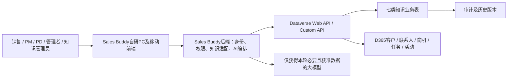

# 赢单领航员知识库：D365实体数据落地与业务准备清单

日期：2026-11-25　版本：V1.2　适用：销售业务、D365实施伙伴、Sales Buddy产品与研发团队

## 1. 方案结论与适用范围

**建议把七类知识建为Dataverse自定义业务表，D365负责权威数据、关系、权限与版本；Sales Buddy保留自研前端和AI服务，通过受控API使用这些数据。** Excel继续作为业务收集、导入和导出载体，MD作为可读说明或版本附件，不作为运行时唯一数据库。

本方案默认合作方使用 **Dynamics 365 Sales Online + Microsoft Dataverse**。若为本地部署的Dynamics 365 Customer Engagement，认证、API及运维方案须重新核对。本文是待实施设计，不表示已经接入合作方租户或完成建表。

本次只设计“赢单领航员知识库”这一板块。个人画像、客户画像、商机画像、评估答案、具体待办、商务活动、Magic Cue和聊天记录属于业务实例，不混存进知识库。

阅读建议：业务侧先看第3、10章；D365实施方看第5–9、11章；产品与验收负责人看第12章。

| 七类知识 | 需要区分的业务实例 |
|---|---|
| 阶段定义 | 某商机当前的M/P/T定位 |
| 阶段判断规则 | 某次评估的结论与销售确认 |
| 画像事项与活动 | 某项目实际的事项状态、CRM任务或商务活动 |
| 追问问题 | 销售本轮回答及画像中的事实 |
| M×P策略 | 某项目当下采用的推进方案 |
| 风险规则 | 某项目已发生或待核实的风险 |
| 资源能力与联系 | 某次资源申请、人员排期或对外承诺 |

**项目的CRM商机阶段只使用S1–S4；M0–M5、P0–P5、T0–T5是独立方法论维度，不能与S阶段互相换算。** 线索仍是独立的Lead实体，不为商机增加S0或S5以后阶段。

### 1.1 七类知识的定义与功能使用位置

| 知识 | 总结定义 | 在哪些对话/功能中使用 | 主要支持的输出 |
|---|---|---|---|
| 阶段定义 | 统一M/P/T各阶段的含义与边界，回答“这个阶段是什么” | 开始/修改MPT评估、查看阶段定义、阶段定位图、解释项目当前定位 | 阶段说明、当前位置及不能直接推导的结论 |
| 阶段判断规则 | 把阶段判断拆成可核对的条件，回答“依据什么判断” | MPT答案核对、阶段复核、“是否满足某阶段/还有什么缺口”的对话 | 支持依据、未知与冲突、需要核实的条件；不自动覆盖用户阶段 |
| 画像事项与活动 | 把阶段重点转为行动模板，回答“接下来做什么” | 推进建议、待办建议、客户沟通或商务活动准备 | 找谁、做什么、准备资料、产出与完成标准 |
| 追问问题 | 用渐进访谈补齐信息，回答“现在最值得问什么” | MPT评估问答、日常对话补充画像、模糊回答后的进一步核实 | 本轮关键事实问题、后续问法与停止条件 |
| M×P策略 | 结合成熟度与我方订单位置，回答“当前目标及投入方式是什么” | MPT画布、浏览矩阵格、“当前优先级/投入程度”的对话 | 当前目标、投入建议、关键动作与下一里程碑 |
| 风险规则 | 根据有依据的信号提示核实与应对，回答“哪些问题需关注” | 现状分析、项目变化影响、“有什么风险/问题”的对话 | 风险或未知的解释、核实问题及应对建议 |
| 资源能力与联系 | 在明确需要支持时说明可用能力和获准渠道，回答“找谁支持、如何申请” | 用户本轮明确询问内部支持、支持角色、申请条件或对接方式 | 能力范围、使用前提、所需资料及已核实的渠道 |

按当前实现，需要特别区分：

- 七类知识不在每轮全部展示，而是根据项目阶段和本次问题选用；默认正文仍为结论、项目简述和最多3项推进建议。
- MPT评估中的固定核实事项主要由**追问题库**生成；“画像事项与活动”当前主要支持对话中的行动建议，不是所有固定画像事项的直接来源。
- 风险规则当前是AI分析依据，尚不是自动扫描CRM并创建项目风险事件的完整规则引擎。
- 资源知识仅在本轮明确请求内部支持时启用，普通现状分析不主动递资源。
- 知识匹配不代表业务执行：用户确认后才创建具体任务；对话补充事实进入画像更新机制，不自动改写公共知识。

例如“分析现状、下一步怎么推进”主要使用定义、规则、策略、活动及相关风险；“采购主体不明确，应该怎么问”主要使用题库和沟通活动；“需要PD或并网专家支持，如何申请”才启用内部资源知识。

## 2. 当前系统事实与Mock核对范围

### 2.1 当前实现

- 后端定义：`apps/server/src/navigator-knowledge.ts`。
- 初始数据：`knowledge/navigator/imports/2026-11-01/`下七份Excel。
- 当前持久化：SQLite的documents中，`navigator_kb_modules`保存模块当前版本指针，`navigator_kb_versions`保存整模块的行数组及填写说明，`navigator_kb_imports`保存导入预览、差异及基准版本。
- 当前维护：Excel上传→校验与差异预览→管理员确认→整模块新版本生效；恢复历史版本也生成一个新版本，不修改旧版本。
- 当前校验包括列名/顺序、必填、重复、阶段合法性等；阶段定义要求18条、M×P矩阵要求36格。其他模块数量允许变化，不能把基线数量当永久业务规则。
- 当前不是D365实体存储；不能把现有SQLite JSON集合直接宣称为Dataverse落地。

### 2.2 本次实际核对结果

核对对象为仓库七份基线Excel，不是合作方租户数据，也不代表云端后来导入的全部版本。

| 模块 | 基线条数 | 现有列数 | 主要质量观察 |
|---|---:|---:|---|
| 阶段定义 | 18 | 6 | 阶段齐全，但部分边界和组合仍需业务确认 |
| 阶段判断规则 | 46 | 8 | 有文字规则，未形成企业确认的结构化判定条件 |
| 画像事项与活动 | 156 | 8 | 部分责任角色、输入输出仍为通用描述 |
| 追问问题 | 199 | 7 | 存在大量相同的三态选项，需补场景化追问与画像字段映射 |
| M×P策略 | 36 | 8 | 格子齐全，但M1×P4、M1×P5明确为“SED规则待补” |
| 风险规则 | 122 | 7 | 有风险叙述，缺统一的触发字段、优先级和验证边界 |
| 资源能力与联系 | 40 | 11 | 40条的部门、姓名、工号、联系渠道均为待确认/待补占位 |
| **合计** | **617** | **55个原始列位置** | **没有空白单元格，不等于内容已具备生产可用性** |

抽查统计还发现：活动“找谁开展”有30条复用同一通用表述，另20条复用另一通用表述；问题“选项与含义”有84条复用一套三态文字、67条复用另一套三态文字。这提示需要业务精炼，不代表这些条目一定无效或应全部删除。

“待核实”“未知”有时是正确的业务状态，不能靠删除这些词来提高完整率。要区分：**方法论尚未定义、企业资源尚未填写、具体项目事实尚未核实**。

## 3. 七类数据：为什么收集、业务如何准备、Mock还缺什么

### 3.1 阶段定义

**定义与使用场景**：用于MPT评估的阶段选择与说明、阶段定义弹窗和定位图，以及对话中解释当前定位；提供阶段语义，不把S阶段换算为MPT。

**收集目的**

统一销售、PM、PD和管理者对M/P/T的语言。让AI知道“这个阶段表示什么、不能推导出什么”，避免根据CRM阶段、单一材料或客户口头态度自动判断成熟度。

**业务准备清单**

- [ ] 明确每个维度的业务含义、18个阶段的正式名称、适用业务模式和责任维护人。
- [ ] 每阶段提供：一句话定义、进入边界、尚不能说明什么、常见误判、一个正例和一个反例。
- [ ] 区分客户陈述、已看到的材料、已核实的条件；明确“申请/受理/附条件批准/正式批准”等状态。
- [ ] 由销售运营/方法论负责人牵头，销售提供真实案例，PM/PD校核开发、技术和实施边界。

**当前基线**

| 维度 | 当前阶段名称，均需合作方确认 |
|---|---|
| M：项目落地成熟度 | M0规划；M1开发推进；M2核心RTB；M3投资级RTB推进；M4开工准备；M5开工建设 |
| P：订单归属/我方订单位置 | P0无有效订单位置；P1接触与首访；P2决策链支持；P3教练实际行为；P4优选；P5中标 |
| T：独立采购进程 | T0未启动；T1 RFI信息征询；T2 RFQ询价；T3 RFP正式招标；T4评标与澄清；T5定标 |

**Mock不足与必须确认**

- 定义是当前产品基线，尚不能视为合作方批准的方法论。
- M2/M3的RTB条件应如何因国家、项目类型而变化，需要实际清单，不能套一套全球许可要求。
- 融资未关闭是否影响某阶段，应结合剩余条件判断，不能单独作为否决M3的条件。
- P3的教练必须体现实际推动行为；友好接触不能自动认定为教练。
- P4/P5须说清主体、供货范围、书面依据及生效条件，不能等同排产、合同生效或回款。
- E0–E3在现有规则中有缺定义提示，但不在18个正式阶段中。业务未定义前不新增E维度或推算E等级。

**上线交付物**：经确认的18阶段定义表＋边界说明＋正反例。缺定义的部分明确标记，不交给模型补写。

### 3.2 阶段判断规则

**定义与使用场景**：用于评估答案核对与阶段复核，也支持对话解释支持依据、未知及冲突；规则给判断依据，不直接更改用户已确认阶段。

**收集目的**

将“凭经验觉得在某阶段”变成可以核对的判断依据，解释为什么支持、为什么暂不支持、缺信息时应该问什么。规则辅助判断，最终阶段仍按既定用户确认流程记录。

**业务准备清单**

- [ ] 每条规则写清：适用维度/阶段、触发场景、必须核实的事项、支持与不支持的条件。
- [ ] 区分“必须条件”“补充信息”“例外”和“不适用”，不以回答数量代替业务判断。
- [ ] 给出一条已满足、一条未满足、一条未知/冲突的案例及期望处理。
- [ ] 明确证据来自谁、何种材料足够、多久需复核；资料未提供时允许保留未知。
- [ ] 销售方法论负责人负责P维度，PM/PD及当地专业方校核M/T涉及的专业条件。

**Mock不足与必须确认**

- 46条主要是自然语言，尚未定义稳定的CRM/画像字段、运算符、优先级与冲突处理。
- 存在多阶段适用文字，需拆成明确关联，不能直接把“M1、P4”解释为同时满足或二选一。
- M1×P4/P5的SED规则、E0–E3含义仍有明确缺口。
- “信息不足”应保留待核，不能自动降低用户已确认阶段；冲突应单列事实及核实建议。
- 一期先存结构化字段中的业务规则文本，不把文本直接当可执行代码。若后续要自动判定，再由业务确认字段、条件及测试集，另建受控规则执行器。

**上线交付物**：规则清单＋条件/证据词典＋正反例测试集＋待补规则登记。

### 3.3 画像事项与活动

**定义与使用场景**：用于生成下一步推进、待办和沟通准备建议。它提供行动模板；当前固定画像核实事项主要由题库生成。

**收集目的**

把当前阶段的重点转换为销售可执行的动作，明确“找谁、做什么、形成什么结果、何时算完成”。它是模板，不是已经发生的商务活动或已经创建的任务。

**业务准备清单**

- [ ] 每条只描述一个可执行动作，写清目的、责任角色、配合角色、输入、产出和完成标准。
- [ ] 区分销售、主责PM、主责PD的职责，以及客户侧的采购、技术、财务和决策角色。
- [ ] 为高频活动准备可分享的材料模板，如负荷资料清单、技术澄清议题、采购路径确认表。
- [ ] 标出适用M/P/T及可选S1–S4标签、国家/地区和业务模式，注明不能使用的情况。
- [ ] 提供至少一个真实成功案例和一个无效活动反例，去除仅“沟通一下”“持续跟进”的条目。

**Mock不足与必须确认**

- 156条中部分输入、责任角色和产出高度通用，不能直接推断具体人员或任务期限。
- “销售与客户/内部专业角色”应进一步说明找哪种角色、针对什么问题；不能自动推荐某位员工。
- 知识活动与固定画像事项之间缺稳定编号关联，需确认哪些只是建议动作、哪些是阶段固定核实项。
- 活动完成不等于许可获批、采购授权成立或项目升阶段。
- 资料的正式模板ID、版本、可对外分享范围、维护人仍需企业提供。

**上线交付物**：优先完成高频活动模板、角色分工表和产出样例；一期无需为凑156条保留低价值重复项。

### 3.4 追问问题

**定义与使用场景**：用于MPT问答及日常对话的渐进核实，参考已有答案决定继续、复核或停止；正文向销售核实事实，与“猜你想问”的AI工作委托分开。

**收集目的**

让领航员用有技巧、可收敛的访谈补充项目画像。围绕当前最影响下一步的问题逐步问，避免一次盘问全部事项或反复询问已回答内容。

**业务准备清单**

- [ ] 每题说明“什么缺口会触发、为什么现在问、期望补哪一个画像字段”。
- [ ] 问题一次只聚焦一个核心事实，区分主体、当前结果、剩余条件和下一节点。
- [ ] 针对明确、模糊、不知道、矛盾、暂不愿答分别准备后续处理和停止条件。
- [ ] 给出销售容易理解的问法，以及必要的客户沟通话术，不只写制度用语。
- [ ] 明确已有有效答案时跳过；信息过期或出现变化时可复核；复核不是把旧答案当不存在。

**Mock不足与必须确认**

- 151条问题复用两套相近的三态选项，未充分体现不同业务问题的具体含义。
- “不同答案如何追问”主要是文字建议，不能宣称已经实现确定性分支流程。
- 缺统一的`画像字段键`、重复问题归并依据、复核触发条件及多语言业务问法。
- 必须区分正文向销售核实的一个关键事实，与“猜你想问”中销售委托AI完成的工作。
- 当前产品默认每轮最多自然追问一个关键事实，不要求每轮必问；用户不知道时给核实路径并继续可推进事项。

**上线交付物**：高频问题卡＋画像字段映射＋回答/追问/停止示例。机器分支需要时再增加专门的选项和分支子表。

### 3.5 M×P策略

**定义与使用场景**：用于MPT画布和矩阵格详情，也用于解释当前目标、投入程度和优先顺序；浏览其他格子的策略不会改变项目当前定位。

**收集目的**

结合项目落地成熟度和我方订单位置，决定当前目标、投入方式、关键动作与下一里程碑。T作为独立采购背景补充判断，不从M/P推导T。

**业务准备清单**

- [ ] 逐格审阅36个组合，明确“可做、暂不做、需要先核实什么”。
- [ ] 投入建议说明投入类别、适用前提和停止/复核信号，不编造成交率、预算额度或人天承诺。
- [ ] 为重点组合提供储能项目案例，说明不同国家、采购主体、EPC/业主关系可能产生的差异。
- [ ] 单独确认M1×P4、M1×P5；未定义前保留“规则待补”。
- [ ] 由销售负责人/SPP Leader牵头，PM/PD确认项目实施与技术前提，管理者确认实际投入边界。

**Mock不足与必须确认**

- 36格结构齐全，但其中2格明确未定义，不能因单元格有文字就算规则完整。
- 部分目标、动作和资源说明是M/P文字的组合，需检验是否真正适合该交叉场景。
- 企业投入授权、区域差异、产品限制和阶段冲突处理尚未形成正式依据。
- “可寻求资源”仅为能力提示，不能默认输出；用户本轮明确询问内部支持后才查询并展示获准的资源信息。
- 规则未定义时禁止AI自动补格或套用邻格；允许记录销售人工申报及待核实说明，不自动覆盖阶段。

**上线交付物**：36格策略、重点格案例及待补格清单。整体可带明确缺口上线，但不能对缺口提供自动判断。

### 3.6 风险规则

**定义与使用场景**：用于现状分析与变化影响对话，将相关信号融入结论或推进建议；当前不等同自动风险事件扫描与建单能力。

**收集目的**

在出现有依据的信号时提醒销售核实和采取行动，避免将“没有记录”当成“没有发生”，或把某种可能性写成项目已发生的问题。

**业务准备清单**

- [ ] 每条写清信号、影响、需要核实什么、建议动作及解除标准。
- [ ] 区分未知、可能风险、已确认风险和已解除；明确适用阶段、地区、业务模式。
- [ ] 若需要排序，提供统一的业务优先级定义和人工判断标准，不让AI凭空计算概率或风险分数。
- [ ] 说明能从CRM或画像哪个字段取数；无数据来源的规则只能作为人工核实指引。
- [ ] 技术、交付、采购、商务/合同等领域分别指定维护责任人，销售提供典型触发案例。

**Mock不足与必须确认**

- 122条中有不少属于常见误判提示，不是可由数据库字段直接触发的项目风险规则。
- 缺统一的触发字段、证据时效、互斥/去重关系及业务优先级。
- 部分关闭标准仍偏通用，需说清谁确认、什么证据足够、何时需要重新打开。
- “并网状态未填”只能表示待核实；“收到明确否决或撤回通知”才是另一类已发生事实。
- 具体项目风险状态应单独存业务实体，不能修改全公司共用的风险知识条目来表示某个项目已解除风险。

**上线交付物**：风险场景词典＋触发事实/反例＋核实动作及关闭标准。

### 3.7 资源能力与联系

**定义与使用场景**：仅用于本轮明确请求内部支持的对话及资源展示，解释支持角色、前提和获准渠道；不因项目有缺口而默认输出。

**收集目的**

在销售明确需要支持时，帮助找到企业真实允许调用的能力和对接渠道，说明使用前提、输入材料和预期产出，而非生成“有专家就能保证解决”的承诺。

**业务准备清单**

- [ ] 按实际部门盘点能力：能支持什么、不能支持什么、覆盖国家/地区、适用项目类型。
- [ ] 确认支持归口、资源负责人、真实联系人、员工身份、获准联系渠道及授权规则。
- [ ] 联系人优先关联企业内部用户目录；多人、主备联系人、区域联系人分别维护，不在一个姓名栏塞多个名字。
- [ ] 提供申请所需资料、实际审批/预约路径、交付结果和需重新确认的条件。
- [ ] 说明信息可见范围、是否允许导出，以及离职/调岗/临时不可用时如何停用。
- [ ] 由资源所属部门确认真实性；销售运营汇总，HR/IT协助人员身份，PM/PD核对专业能力范围。

**Mock不足与必须确认**

- 40/40条部门为建议归口或待企业确认；40/40姓名、工号、联系渠道均为占位，不能用于实际联系。
- 当前覆盖“通用、欧洲、北美、中东、亚太”，尚不足以证明某国家的资质、权限或本地支持能力。
- COME3.0等渠道只是待核实描述，不代表已经有可用API、账号或深链。
- 未提供真实排期、服务约定和资源可用性数据，不能承诺响应时间、人员安排或支持费用。
- 业务应确认哪些能力即使有描述也不可对销售开放；未核实联系人时只显示“能力说明/具体对接人待确认”，不出现伪造联系按钮。
- 初次迁移可保留40条作为待确认盘点模板，但不能转成40条“已可用资源”，也不能创建姓名为“待补充”的联系人或系统用户。

**上线交付物**：经各归口确认的能力清单＋真实联系人绑定＋渠道与权限规则。不能直接把现有40条当成已可调用资源发布。

## 4. D365/Dataverse落地架构与责任边界



| 层 | 应负责 | 不应承担 |
|---|---|---|
| D365/Dataverse | 权威数据、字段与关系、真实用户/团队权限、版本、审计、服务端约束 | 靠前端隐藏按钮代替权限；把项目私有画像放进公共知识 |
| Sales Buddy前端 | 七类清单、详情、检索、Excel预览、确认生效、PC/手机交互 | 持有应用密钥；绕过后台直接让AI改知识 |
| Sales Buddy后端 | Entra身份验证、Dataverse适配、版本快照、按需检索、模型上下文、来源 | 用一个全权限账号把全部数据读出后仅凭前端userId过滤 |
| Dataverse插件/Custom API | 不可变版本保护、关联完整性、并发生效与重复请求处理 | 在插件里调用大模型或执行长时间Excel解析 |

Dataverse应通过受支持的Web API/SDK读写。其TDS SQL端点是只读查询能力，不是允许Sales Buddy直接写底层SQL的入口。[微软：Dataverse SQL查询](https://learn.microsoft.com/en-us/power-apps/developer/data-platform/dataverse-sql-query)

不建议强行把七类结构都放进Customer Service的文章正文：文章/附件可存解释材料，但阶段、规则、策略格和资源绑定仍需要明确字段与关系。本版只展示七类知识的业务实体。实体统一使用`catl_esspilot_`前缀，自定义字段统一使用`catl_`前缀；需在合作方Solution Publisher中配置并核对`catl`前缀，逻辑名不能仅改显示名。Dataverse原生字段保留原名。

## 5. 建表清单与公共字段

### 5.1 七类知识业务实体清单

| # | 实体中文名 | 建议实体逻辑名 | 保存内容 | 关键约束 |
|---|---|---|---|---|
| 1 | 阶段定义 | `catl_esspilot_stage` | M/P/T阶段的名称、说明、判断要点与常见误判 | 同一版本的阶段代码唯一，完整覆盖18阶段 |
| 2 | 阶段判断规则 | `catl_esspilot_stagerule` | 适用条件、应确认事项、判定标准、缺信息的追问及例外 | 版本＋知识编号唯一，适用阶段有效 |
| 3 | 画像事项与活动 | `catl_esspilot_activity` | 活动目的、具体动作、责任角色、输入、产出和完成标准 | 版本＋知识编号唯一，不保存实际项目任务状态 |
| 4 | 追问问题 | `catl_esspilot_question` | 提问时机、问题、答案含义、追问和停止条件 | 版本＋题号唯一，可映射固定画像字段 |
| 5 | M×P策略 | `catl_esspilot_mpstrategy` | M/P组合目标、投入建议、动作、风险、资源提示与里程碑 | 同一版本的M/P组合唯一，完整覆盖36格 |
| 6 | 风险规则 | `catl_esspilot_risk` | 触发信号、影响、核实问题、应对和解除标准 | 版本＋知识编号唯一，不保存某项目风险是否已关闭 |
| 7 | 资源能力与联系 | `catl_esspilot_resource` | 能力、范围、使用前提、资料、归口、主联系人及渠道 | 版本＋知识编号唯一，真实联系信息按权限展示 |

本清单仅列这七张知识业务表，不再展开模块、版本、导入批次、发布控制或联系人子表。用户目录、团队、审计及统一配置等复用合作方既有平台能力；版本、导入和原子生效仍是需要实现的功能，不能因不列技术表就省略这些能力。

多阶段适用先使用`catl_applicablestages`多选Choice，选项限定为18个M/P/T代码，不新增一张适用阶段业务表。阶段标签表示适用范围；明确的M/P组合条件另用本表条件字段和`catl_matchmode`表达，不能从标签串猜测逻辑。

资源表一期维护主联系人及可选备用联系人。若地区、职责或授权范围不同，拆成有独立编号的能力范围记录；不在本版增加联系人子表。

### 5.2 公共字段

| 字段 | 类型建议 | 填写/使用要求 |
|---|---|---|
| 原生主键 | Dataverse GUID | 系统生成，不拿项目编号或姓名代替GUID |
| `catl_code` | 文本80 | 稳定业务编号，如RULE-0001；跨环境及导入匹配使用 |
| `catl_name` | 文本200 | 业务名称，允许改名；不作为长期唯一键 |
| `catl_version` | 文本40 | 所属模块的业务版本标识，所有知识行必有；生效版本不原地改写 |
| `catl_readiness` | Choice | 业务已确认／企业资料待补／方法论未定义，区别于技术发布状态 |
| `catl_region`、`catl_businessmode` | 受控Choice/多选 | 地区与业务模式字典由合作方确认，不做自由拼写 |
| `catl_crmstagetags` | S1–S4多选标签，可空 | 仅检索标签，不把S阶段映射为M/P/T；未标记不能解释为不适用 |
| `catl_language` | 文本35 | 如zh-CN；多语言另行约定版本/翻译关系 |
| `catl_source` | 多行文本 | 正式制度/文档编号、版本、适用范围及获准来源链接 |
| `catl_confirmedby`、`catl_confirmedon` | SystemUser Lookup、日期时间 | 业务内容确认责任与时间，不等同系统修改人 |
| `catl_reviewdue` | 日期 | 下次复核日；到期提醒不能直接把知识当错误事实 |
| `catl_sortorder` | 整数 | 业务顺序，不用数据库插入顺序驱动提问 |
| 原生createdon/modifiedon/ownerid/versionnumber | 原生审计/并发字段 | 不重复造同名审计字段；RowVersion用于并发，不等同业务版本号 |

业务正文建议配置为多行纯文本，按现有每单元格12000字的边界评估长度。原始文件可用Dataverse文件列或合作方既有SharePoint文档库；避免把二进制或整份MD塞进正文列。

业务键建议用“catl_version＋catl_code”；阶段和矩阵使用相应组合键。Dataverse支持替代键，但应在目标环境确认键已成功创建且可用，不把姓名、手机号或带列级保护的字段作为导入匹配键。[微软：替代键](https://learn.microsoft.com/en-us/power-apps/developer/data-platform/define-alternate-keys-entity)

## 6. 七类现有列到Dataverse字段的映射

下面“必填”对应当前模板要求；暂存草稿可容纳待补值，但确认生效必须在服务端校验，不能只依赖页面上的必填标识。字段名可由合作方按命名规范调整。

### 6.1 阶段定义 `catl_esspilot_stage`

| 原列 | 建议字段 | 类型 | 必填 | 准备要求 |
|---|---|---|---|---|
| 所属维度 | `catl_axis` | Choice：M/P/T | 是 | 不增加S或未定义E |
| 阶段 | `catl_code` | 文本 | 是 | M0–M5/P0–P5/T0–T5；校验维度一致 |
| 阶段名称 | `catl_name` | 文本 | 是 | 正式业务叫法 |
| 阶段说明 | `catl_definition` | 多行文本 | 是 | 说明含义及边界 |
| 判断要点 | `catl_criteria` | 多行文本 | 是 | 可核对事实，不是勾选数量 |
| 常见误判 | `catl_misinterpretation` | 多行文本 | 否 | 正反例与不能推导的事项 |

### 6.2 阶段判断规则 `catl_esspilot_stagerule`

| 原列 | 建议字段 | 类型 | 必填 | 准备要求 |
|---|---|---|---|---|
| 规则名称 | `catl_name` | 文本 | 是 | 新增独立catl_code，不以改名生成新规则 |
| 适用维度 | `catl_axis` | Choice | 是 | 与适用阶段核对 |
| 目标阶段 | `catl_applicablestages` | 多选Choice | 是 | 支持一条规则关联多个阶段 |
| 适用条件 | `catl_applicability` | 多行文本 | 是 | 写清适用与不适用 |
| 应确认事项 | `catl_checkpoints` | 多行文本 | 是 | 后续映射固定画像字段/事项键 |
| 判定标准 | `catl_decisioncriteria` | 多行文本 | 是 | 满足、未满足、未知如何处理 |
| 信息不足时如何追问 | `catl_missinginfofollowup` | 多行文本 | 是 | 不代填事实，不无限循环 |
| 例外说明 | `catl_exceptions` | 多行文本 | 否 | 国家、业务模式、条件性安排 |

补充`catl_matchmode`表示适用阶段是任一/组合条件；真正“M与P同时满足”的规则还要有明确的M/P条件，不能靠一串阶段标签猜测逻辑。

### 6.3 画像事项与活动 `catl_esspilot_activity`

| 原列 | 建议字段 | 类型 | 必填 | 准备要求 |
|---|---|---|---|---|
| 活动名称 | `catl_name` | 文本 | 是 | 一个可执行动作 |
| 适用阶段 | `catl_applicablestages` | 多选Choice | 是 | 解析并校验全部阶段 |
| 活动目的 | `catl_objective` | 多行文本 | 是 | 为什么在当前阶段做 |
| 具体动作 | `catl_action` | 多行文本 | 是 | 不是“持续跟进”等空话 |
| 找谁开展 | `catl_targetroles` | 多行文本/受控角色 | 是 | 客户角色与内部S/PM/PD分开 |
| 需准备资料 | `catl_inputs` | 多行文本 | 否 | 有正式资料时给文档编号/版本 |
| 应形成结果 | `catl_outputs` | 多行文本 | 是 | 可检查的产出 |
| 完成判定 | `catl_completioncriteria` | 多行文本 | 是 | 不等同项目升阶段 |

建议增加`catl_profilefieldkey`（文本，可空），连接已经确认的画像固定字段/事项键；它不是某个商机的事项状态。

### 6.4 追问问题 `catl_esspilot_question`

| 原列 | 建议字段 | 类型 | 必填 | 准备要求 |
|---|---|---|---|---|
| 问题名称 | `catl_name` | 文本 | 是 | 稳定题号另用catl_code |
| 适用阶段 | `catl_applicablestages` | 多选Choice | 是 | 不按CRM阶段自动选全部题 |
| 什么时候问 | `catl_triggerguidance` | 多行文本 | 是 | 未知、过期、变化或冲突的具体条件 |
| 问题内容 | `catl_questiontext` | 多行文本 | 是 | 单个核心事实，业务自然语言 |
| 选项与含义 | `catl_answerguidance` | 多行文本 | 否 | 一期保留文本；不是已实现的程序分支 |
| 不同答案如何追问 | `catl_followupguidance` | 多行文本 | 否 | 明确/模糊/不知道/冲突各如何处理 |
| 什么时候结束 | `catl_stopcriteria` | 多行文本 | 是 | 已回答、不适用、用户不知道或暂不回答 |

建议增加`catl_profilefieldkey`、`catl_priority`、`catl_recheckcondition`。只从获准且相关的问题中选择本轮最有价值的一个；这些字段不允许给模型任意创建画像字段的权限。

### 6.5 M×P策略 `catl_esspilot_mpstrategy`

| 原列 | 建议字段 | 类型 | 必填 | 准备要求 |
|---|---|---|---|---|
| M阶段 | `catl_mstageid` | Lookup→M阶段行 | 是 | 所引用阶段属于该发布组合的阶段版本 |
| P阶段 | `catl_pstageid` | Lookup→P阶段行 | 是 | 不引用T或CRM阶段 |
| 当前目标 | `catl_objective` | 多行文本 | 是 | 一个明确阶段目标 |
| 投入建议 | `catl_investmentguidance` | 多行文本 | 是 | 投入方式及前提，不是已获授权预算 |
| 关键动作 | `catl_keyactions` | 多行文本 | 是 | 可转成建议待办 |
| 风险提醒 | `catl_riskguidance` | 多行文本 | 否 | 与风险库一致，不编造成事件 |
| 可寻求资源 | `catl_resourceguidance` | 多行文本 | 否 | 按需展示，不是实际人员承诺 |
| 下一里程碑 | `catl_nextmilestone` | 多行文本 | 是 | 描述完成结果，不推算合同日期 |

M1×P4/P5用`catl_readiness=方法论未定义`显式表达；“有36条”与“36格均有正式规则”是两项不同的检查。

### 6.6 风险规则 `catl_esspilot_risk`

| 原列 | 建议字段 | 类型 | 必填 | 准备要求 |
|---|---|---|---|---|
| 风险名称 | `catl_name` | 文本 | 是 | 单一风险或误判主题 |
| 适用阶段 | `catl_applicablestages` | 多选Choice | 是 | 可以覆盖多个阶段 |
| 触发信号 | `catl_triggersignal` | 多行文本 | 是 | 事实、未知、推测要区分 |
| 可能影响 | `catl_impact` | 多行文本 | 是 | 条件性描述，不伪造损失金额 |
| 需要核实的问题 | `catl_verificationquestion` | 多行文本 | 是 | 可关联题库题号，不能强制一次问完 |
| 应对动作 | `catl_responseaction` | 多行文本 | 是 | 面向销售可推进动作 |
| 解除或关闭标准 | `catl_resolutioncriteria` | 多行文本 | 是 | 谁确认、什么结果足够 |

`catl_priority`、`catl_factfieldkey`等补充字段须在业务确认口径后启用；规则库不存某项目的“已关闭”状态。

### 6.7 资源能力与联系 `catl_esspilot_resource`

| 原列 | 建议位置/字段 | 类型 | 必填 | 准备要求 |
|---|---|---|---|---|
| 资源名称 | 资源表`catl_name` | 文本 | 是 | 能力名称，不以某人名字作资源名 |
| 资源类别 | 资源表`catl_category` | Choice | 是 | 当前11类仅作基线，由企业统一字典 |
| 适用地区 | 资源表`catl_region` | 受控地区字段 | 是 | 必要时增加国家/资格限制 |
| 适用阶段 | `catl_applicablestages` | 多选Choice | 是 | 不证明资源实际可用 |
| 能支持什么 | 资源表`catl_capability` | 多行文本 | 是 | 同时明确不能承诺什么 |
| 使用前提 | 资源表`catl_prerequisites` | 多行文本 | 是 | 权限、材料、适用边界 |
| 准备资料 | 资源表`catl_requiredinputs` | 多行文本 | 否 | 正式输入及版本 |
| 对接部门 | 资源表`catl_departmenttext`，可选`catl_supportteamid` | 说明文本、Team Lookup | 是 | 先确认业务归口；不能默认把部门等同Dataverse Business Unit |
| 联系人姓名 | 资源表`catl_contactuserid`及显示名 | SystemUser Lookup | 否 | 未匹配不得据姓名模糊绑定内部人 |
| 工号 | 从用户/HR映射读取；必要时资源表`catl_employeeno` | 文本/受保护列 | 否 | 由合作方确认真实字段，不假定标准用户表已有指定工号列 |
| 联系渠道 | 资源表`catl_channeltype`、`catl_channelvalue` | Choice、受保护文本 | 否 | 企业批准的渠道/链接；无真实入口不生成按钮 |

资源表补充`catl_contactrole`（支持角色）、`catl_backupcontactuserid`（备用用户Lookup）、`catl_contactstatus`（有效/撤销）及`catl_contactverifiedon`（最近确认时间）。一期每个能力范围记录明确一个主联系人，备用联系人可空，不能在姓名栏拼接多人。

内部专家若尚未映射为Dataverse SystemUser，由IT确认是否使用企业目录/HR的稳定身份外键及受控查询适配，不为匹配姓名自动创建用户或承诺其许可。若后续开放外部机构资源，再单独设计Account/Contact关联与授权，不能把外部客户联系人当内部员工。

联系人调岗、停用或渠道撤销应立即影响实际联系能力，不能靠切回历史知识版本恢复权限。历史资源版本仅说明当时引用的知识，实际使用时仍校验当前用户权限、人员状态与渠道有效性。资源记录应按联系人所需的最严格可见范围授权；若要求能力广泛共享但联系人单独保密，再由IT确认平台支持的字段保护或受控目录查询，不把前端隐藏字段当成安全隔离。

## 7. 关系、版本与导入的实现方式

### 7.1 七表内的关系与版本边界

- [ ] 阶段定义保存18个正式代码；规则、活动、问题、风险和资源通过`catl_applicablestages`声明适用范围。
- [ ] M×P策略的`catl_mstageid`、`catl_pstageid`分别引用阶段定义，服务端校验维度及版本兼容。
- [ ] 问题和活动的`catl_profilefieldkey`只指向既定画像字段键，不是新建画像实体或动态字段的入口。
- [ ] 资源的主/备联系人引用合作方既有用户目录，归口团队可引用既有Team；不另列资源联系人实体。
- [ ] 七表均保存`catl_code`和`catl_version`；对话及评估保存本次实际使用的七类版本清单及行引用。
- [ ] 当前生效版本组合、导入状态及幂等信息由合作方既有配置/受控版本服务承接，本版只规定行为，不展开新增技术实体。
- [ ] 知识不逐条复制到每个商机。知识行是方法，商机的阶段、回答、任务与风险状态仍存在对应业务数据中。

普通单类更新保持其他六类内容稳定。阶段定义变化时，依赖的规则、矩阵与适用范围必须重新校验，不能把新版阶段与不兼容旧规则混用。具体历史存储及统一切换实现由实施方对接已有平台机制，并按本方案验收。

### 7.2 延续当前维护体验，不新增多级审批

1. 业务上传Excel，后端在暂存区解析，不改当前生效内容。
2. 校验字段、稳定编号、关联阶段、必填、重复、业务就绪标记，展示新增/修改/移除差异。
3. 管理员点击“确认生效”；这是现有确认步骤，不另加一套业务审批流。
4. 生成带新`catl_version`的数据行，校验后封存；检查其与其他六类当前版本的兼容性。
5. 确认生效操作在受控的小范围事务中检查基准版本及并发值，统一更新生效版本清单；不能逐条启停导致半套内容可见。
6. 保留历史知识版本和切换记录。回滚重新确认要使用的版本组合，记录原因与操作者，不删除中间历史。

技术状态可用草稿/校验中/已就绪/已封存等；它们不是新增业务审批节点。内容的“方法论未定义/企业资料待补”是另一个维度，不能用技术“生效”掩盖内容缺口。

一期模板继续兼容现有七份列结构；新增稳定编号等字段应升级模板版本并提供适配，不能让旧模板静默错列。现有按名称判重只能作为初始迁移辅助；首次迁移分配稳定编号后，后续按编号匹配，禁止改名即新增。

### 7.3 事务、并发与审计

- 大文件解析、批量写入和业务校验放在异步导入任务中，不能把模型请求或全部数据迁移塞进同步插件。
- 普通批量请求不天然等于原子事务。需要原子提交时使用Dataverse支持的change set/事务，最终生效仅切换少量控制记录。Web API batch单次最多1000个请求，实际分批还需考虑条目及关联总数。[微软：批量与change set](https://learn.microsoft.com/en-us/power-apps/developer/data-platform/webapi/execute-batch-operations-using-web-api)
- 对知识记录及既有配置中的版本控制使用ETag/RowVersion。并发基准不一致就返回冲突、保留草稿，不覆盖他人刚生效的版本。[微软：条件操作](https://learn.microsoft.com/en-us/power-apps/developer/data-platform/webapi/perform-conditional-operations-using-web-api)
- 封存业务行的Update/Delete、绕过确认直接改生效版本等操作要在服务端受控；仅隐藏按钮挡不住直接Web API调用。发布Custom API须检查调用者权限、版本兼容及幂等请求，不能仅有一个空API定义。[微软：Custom API](https://learn.microsoft.com/en-us/power-apps/developer/data-platform/custom-api)
- 对表、关键列和权限变更启用合适的审计。审计不是不可变知识版本的替代；读取/导出跟踪需要另外配置相应活动日志。[微软：Dataverse审计](https://learn.microsoft.com/en-us/power-platform/admin/manage-dataverse-auditing)

## 8. 身份、权限与资源可见性

### 8.1 建议首版使用用户/团队所有表

知识方法论虽可全体销售共享，但技术草稿、历史版本和真实人员联系方式并不必然应全部公开。因此建议上述表在创建时优先采用用户/团队所有模式：由知识维护团队拥有，生效后的方法论按只读权限共享给获准读者团队，资源表中的联系信息保留区域/归口限制。

如果合作方确认所有草稿和版本都允许同一读者范围查看，可简化部分方法论表为组织所有；但不能以一个“已发布”字段配合前端过滤，宣称形成了记录级安全隔离。表所有权类型在创建时决定，事后不能直接切换。[微软：所有权及安全](https://learn.microsoft.com/en-us/power-platform/admin/wp-security-cds)

| 角色 | 建议权限 |
|---|---|
| 销售、PM、PD、管理者 | 对获准生效方法论只读；资源联系人按实际范围可读；不自动因管理职级获得所有联系方式 |
| 知识维护人 | 在授权模块/区域创建和编辑技术草稿，不能改已封存内容 |
| 知识管理员 | 对获准知识集进行导入确认、生效与回滚；一期可与维护人合并职责 |
| D365平台管理员 | 表、Solution、角色、插件和环境管理；不把技术管理权限当成AI使用全部数据的理由 |
| 集成/后台应用用户 | 仅被授予完成导入或受控后台任务所需权限，不默认System Administrator |

落地检查：

- [ ] 使用真实Entra用户与Dataverse安全角色，生产不保留当前Mock身份切换作为认证机制。
- [ ] 优先验证用户委派/OBO方案，让Dataverse按当前用户判断权限；客户端密钥或证书不得进浏览器。
- [ ] 如使用应用用户代用户操作，只能按服务端验证的身份建立调用上下文，不能直接信任浏览器传来的CallerObjectId或userId。受支持的模拟执行还要求相应平台权限。[微软：模拟用户执行](https://learn.microsoft.com/en-us/power-apps/developer/data-platform/webapi/impersonate-another-user-web-api)
- [ ] 读者需要相应表的基础Read权限；Owner Team/Access Team、共享及子记录读取要显式设计，不假定建立Lookup就自动继承全部访问权。
- [ ] 发布与回滚共享哪些行、历史行保留哪些读权、资源撤权如何覆盖旧版本，写成可验收规则。
- [ ] 工号、手机号等可按企业要求增加列级保护；导出同样遵守调用者权限。
- [ ] SPP是销售/PM/PD协作组织，不默认等同Dataverse Business Unit。是否用Owner Team、Access Team或额外业务团队实体由合作方确认。

## 9. Sales Buddy接口、检索与AI使用方式

### 9.1 接口建议

| Sales Buddy后端能力 | 七类知识实体的使用方式 | 保留的前端行为 |
|---|---|---|
| 七类清单/详情 | 查询对应`catl_esspilot_`实体，按当前获准版本过滤 | 搜索、筛选、分页和详情 |
| 下载模板/导出 | 根据七表字段生成Excel，联系信息按权限过滤 | 保留七类模板及同列预览 |
| 上传预览 | 服务端暂存和校验，未确认前不改生效数据 | 展示差异与错误，失败保留上下文 |
| 确认生效 | 受控确认接口检查基准版本、依赖关系及幂等请求 | 明确确认后才切换版本 |
| 历史/恢复 | 按`catl_version`读取历史，通过受控流程恢复 | 可追溯，不覆盖中间历史 |
| 领航员检索 | 先固定七类生效版本，再从七表按条件及权限选内容 | 简答、追问、MPT画布与来源详情 |

示意如下。实体集名、导航属性及Custom API参数必须以实际`$metadata`为准。当前版本清单由合作方已有配置/版本能力经Sales Buddy后端提供，不在清单中新增目录或发布实体。

```http
GET /api/navigator-knowledge/current-versions

GET https://<organization>/api/data/v9.2/<StageRuleEntitySet>?$select=catl_code,catl_name,catl_decisioncriteria&$filter=catl_version eq '<version>'

POST https://<organization>/api/data/v9.2/catl_ConfirmKnowledgeImport
Content-Type: application/json

{
  "catl_modulecode": "rules",
  "catl_expectedversion": "<current-version>",
  "catl_targetversion": "<validated-new-version>",
  "catl_requestid": "<idempotency-guid>"
}
```

以上确认API为建议开发项，不是Dataverse预置接口；这些`catl_`参数是接口参数，不是额外实体。OAuth应使用正确的目标受众，不能把发给Sales Buddy API的token直接当Dataverse token。[微软：Dataverse认证](https://learn.microsoft.com/en-us/power-apps/developer/data-platform/authentication)

### 9.2 每轮对话的数据顺序

1. 校验用户对该商机、客户和相关画像的当前权限。
2. 从Dataverse读取商机最新数据、本人可用画像和相关进展；S阶段与MPT分开。
3. 从受控配置读取当前七类生效版本，固定本轮版本清单；一次MPT评估从开始到结束使用同一清单。
4. 根据已确认M/P/T和当前问题选阶段、规则、策略、活动、风险及少量问题，避免把617条全部塞给模型。
5. 只有本轮明确询问内部支持，才读有权限的资源能力和联系人；“有资源需求猜测”或历史讨论不算当前请求。
6. 模型默认输出结论、项目简述和最多3项待办，适时只追问一个关键事实；新事实进入原有画像机制，知识库不被会话自动修改。
7. 保存来源的行GUID、`catl_code`、`catl_version`、本轮七类版本清单及获取时间。回看历史时仍检查当前权限，不因历史引用继续泄露已撤权联系信息。

缓存可用于性能优化，但不是第二个权威数据源。缓存必须区分租户/环境、知识版本组合和访问范围；资源联系人、私有内容不能用全体用户共用缓存直接返回。若日后引入向量索引，须沿用版本与权限过滤，不另建一套独立“真知识”。

服务端分页处理`@odata.nextLink`，不假设一次取完。遇到429遵循服务端退避信息重试，导入使用幂等键，不让重试重复发布。[微软：服务保护限制](https://learn.microsoft.com/en-us/power-apps/developer/data-platform/api-limits)

## 10. 业务和D365伙伴需确认的清单

### 10.1 上线前必须确认

| 优先级 | 待确认项 | 建议主责 | 未确认时的处理 |
|---|---|---|---|
| P0 | 18阶段的正式定义、RTB边界、P3教练行为、P4/P5有效依据 | 销售方法论负责人＋PM/PD | 保留指导性状态，不自动推断阶段 |
| P0 | M1×P4/P5的SED规则；E0–E3是否存在及其含义 | 方法论负责人 | 标为未定义，不补写、不新增维度 |
| P0 | 资源真实能力、部门、联系人、授权渠道与可见范围 | 资源部门＋HR/IT | 不提供实际联系按钮或排期承诺 |
| P0 | D365版本、Dataverse环境、Entra身份、许可及应用用户方案 | D365平台负责人 | 未核实前不承诺已可接入或调用额度 |
| P0 | 真实商机S1–S4字段/流程阶段的逻辑名及枚举映射 | CRM业务负责人＋实施方 | 不假定标准字段与当前应用一一对应 |
| P0 | 草稿/历史/资源的读写范围及共享方式 | 安全管理员＋业务负责人 | 不以页面筛选代替平台权限 |
| P1 | 高频活动的S/PM/PD及客户角色分工、输入输出模板 | 销售运营＋PM/PD | 通用描述不得变成具体人员承诺 |
| P1 | 题库到固定画像字段的映射及停止/复核规则 | 销售专家＋产品 | 不自动新增画像字段，不重复追问 |
| P1 | 风险的事实字段、优先级、误触发反例和关闭标准 | 各领域业务负责人 | 只作核实提醒，不写成已发生事件 |
| P1 | 国家/地区、业务模式、语言及资料对外授权 | 区域业务及专业负责人 | 不将某地要求当全球统一规定 |
| P1 | 导入、切换、回滚、审计和历史引用的验收样例 | D365实施方＋Sales Buddy研发 | 不直接覆盖当前生效记录 |
| P2 | 可执行规则条件、机器问题分支、向量检索 | 业务＋研发 | 一期不依赖这些能力上线 |

业务确认是内容准备工作，不代表必须在产品中新增多级审批。

### 10.2 业务交付包

- [ ] 七份清单，使用稳定编号，保留当前55列的明确映射。
- [ ] 方法论定义及关键规则的正例、反例、未知/冲突例。
- [ ] 高频活动的责任角色和输出模板。
- [ ] 高频问题的触发→回答→后续处理→停止样例。
- [ ] 风险事实来源及关闭证据清单。
- [ ] 企业确认的资源能力、人员身份及渠道，不交付虚构姓名/链接。
- [ ] 每条内容的来源、维护人、确认日期和复核周期；明确哪些仍是待补项。
- [ ] S1–S4、国家/地区、业务模式适用标签；不与MPT做等值映射。

## 11. 实施顺序与交付清单

| 阶段 | 工作 | 完成标志 |
|---|---|---|
| 1 业务定稿 | 七类目的/边界、优先内容、缺口登记、真实资源盘点 | P0事项有明确结论或保守处理规则 |
| 2 D365建模 | 表、列、关系、替代键、所有权与安全角色 | 元数据与权限用真实用户验证通过 |
| 3 模板与初次导入 | 稳定编号、v1/v2模板适配、阶段关联及差异预览 | 617条基线可追溯导入，待补项不伪装已确认 |
| 4 版本与接口 | 导入任务、不可变版本、发布Custom API、并发与回滚 | 同时发布、重复确认、失败恢复均不覆盖有效版本 |
| 5 Sales Buddy适配 | 将现有本地知识库适配器换成Dataverse实现 | 前端保持七类维护体验，AI使用受控版本和来源 |
| 6 业务验收 | 销售/PM/PD/管理者场景、移动简答、资源按需展示 | 关键正反例、权限、历史和回滚通过 |

D365交付物包括Solution中的表结构、关系、Choices、安全角色、插件/Custom API和必要表单/视图；知识内容及用户/团队绑定需另有可重入的数据迁移包，不能认为部署Solution就会自动搬入全部617条业务数据。[微软：Power Platform ALM](https://learn.microsoft.com/en-us/power-platform/alm/basics-alm)

开发、测试、生产环境分别部署。跨环境用稳定业务编号匹配内容，用户/团队按目标环境的真实身份映射；不能直接复制SystemUser/Team GUID或靠姓名猜人。

## 12. 验收清单

- [ ] 18个阶段与36个矩阵组合完整；不存在重复阶段/重复组合或跨维度错误Lookup。
- [ ] 其他模块数量可调整，稳定编号不随改名改变，多阶段适用关系解析正确。
- [ ] 方法论未定义、企业资料待补、项目事实未知能被分别表达。
- [ ] 两个管理员基于同一旧版本操作，后提交者得到冲突，原草稿保留。
- [ ] 重复点击确认/重试导入不产生重复生效版本；失败不改变当前生效版本组合。
- [ ] 直接Web API改封存内容或绕过发布入口被服务端拒绝。
- [ ] 普通销售无法通过直接API读到未共享草稿、越区联系人或他人的私有画像。
- [ ] 知识版本回滚后，旧对话/评估仍能定位原引用；撤权信息不因历史版本恢复访问。
- [ ] 默认简答不带内部资源和完整题库；明确请求支持时才返回当前有权限且有效的资源信息。
- [ ] 每轮最多自然追问一个关键事实，已知答案跳过，用户不知道时不循环追问。
- [ ] 任务建议仍经用户确认才创建CRM记录，不因知识匹配自动升阶段、完成任务或承诺资源。
- [ ] 首次接入不覆盖原CRM客户、商机、会话、画像、知识后台已维护版本或人员目录。

## 13. 主要核对依据

**本地实现依据**：`apps/server/src/navigator-knowledge.ts`、`navigator.ts`、`navigator-reply.ts`、`agent.ts`及七份2026-11-01基线Excel。本次统计仅读取仓库知识文件，未读取合作方租户，未将真实项目资料发送给模型。

**微软官方技术依据（2026-11-25核对）**：

- [Dataverse Web API操作概览](https://learn.microsoft.com/en-us/power-apps/developer/data-platform/webapi/perform-operations-web-api)
- [表关系](https://learn.microsoft.com/en-us/power-apps/maker/data-platform/create-edit-entity-relationships)
- [替代键](https://learn.microsoft.com/en-us/power-apps/developer/data-platform/define-alternate-keys-entity)
- [所有权与安全](https://learn.microsoft.com/en-us/power-platform/admin/wp-security-cds)
- [OAuth与Web服务认证](https://learn.microsoft.com/en-us/power-apps/developer/data-platform/authentication)
- [模拟用户执行](https://learn.microsoft.com/en-us/power-apps/developer/data-platform/webapi/impersonate-another-user-web-api)
- [Custom API](https://learn.microsoft.com/en-us/power-apps/developer/data-platform/custom-api)
- [ETag与条件操作](https://learn.microsoft.com/en-us/power-apps/developer/data-platform/webapi/perform-conditional-operations-using-web-api)
- [批处理与change set](https://learn.microsoft.com/en-us/power-apps/developer/data-platform/webapi/execute-batch-operations-using-web-api)
- [服务保护限制](https://learn.microsoft.com/en-us/power-apps/developer/data-platform/api-limits)
- [审计](https://learn.microsoft.com/en-us/power-platform/admin/manage-dataverse-auditing)
- [ALM基础](https://learn.microsoft.com/en-us/power-platform/alm/basics-alm)
- [TDS只读SQL查询](https://learn.microsoft.com/en-us/power-apps/developer/data-platform/dataverse-sql-query)

表拆分、字段名、发布清单及角色分工是本方案建议，不是微软预置的Sales Buddy数据模型；落地前需由合作方按实际租户、业务定义及权限治理确认。
