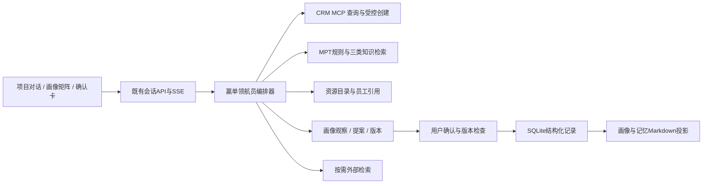

# 赢单领航员：产品设计与落地实施方案

版本：1.0；日期：2026-11-01。适用：Sales Buddy 海外储能销售团队。

本次交付为Pencil原型整理及实施设计，没有修改运行中的应用、数据库、个人记忆或CRM记录。本文明确区分现有能力与拟开发能力；不将画布中的成功状态视为接口已经实现。

配套文件：

- [MPT策略、画像活动与资源知识库](赢单领航员-MPT策略与画像活动知识库设计.md)
- [原型分区、组件与审查记录](赢单领航员-原型组件与分区审查.md)
- 正式设计源：`designs/CRM智能助手vzyh_2026.9.23.pen`。

## 1. 产品定位与业务边界

**赢单领航员**统一承载“项目阶段识别、策略打法、资源建议及项目画像演进”。它围绕一个具体销售项目持续工作，帮助销售回答：项目现在在哪里、最值得推进什么、哪些风险尚未解决、内部可以找谁、哪些新事实需要更新到画像。

“定方向、识风险、递资源”是同一回答的三个业务视角，不做三个互相割裂的聊天机器人，也不要求用户在每次提问前选择模式。

- 定方向：依据M×P位置、独立T采购窗口及真实卡点，给出目标、投入方式与下一里程碑。
- 识风险：区分条件尚未满足、信息未知、资料过期、事实冲突、采购主体变化，指出对推进的实际影响。
- 递资源：说明哪项行动可申请哪些支持、适用前提、需要材料、归口人和联系渠道。

一期以售前推进为重点，兼顾交付、验收和回款。分析与资源推荐不等于融资、报价、交期、投资或排产授权。商务承诺仍由企业现有流程决定。

### 命名与入口

- P10.42及以后的项目画像与推进页面统一显示“赢单领航员”。
- 现有客户级战略咨询可以保留在原战略参谋模块；当需要项目阶段判断时，必须明确选中线索或商机。
- 首页/功能导航提供赢单领航员入口，选择客户后列出其项目；不能把整个客户当作一个MPT项目。
- 历史页面编号保留，页面标题加功能名；本次不重编号、不覆盖已删除原型。

## 2. 依据与已确定的口径

方法论来源为工作区“销售策略”下的两份文件：

- `MPT矩阵生成与销售策略展示.pptx`：4页；第1页定义M×P位置、投入风险色块及T轨迹，第2页定义事实、建议、申报与核验，第3页定义采购事件，第4页定义模糊拜访追问。
- `MPT销售策略Agent整体训练规则与交互工作底稿(2)(1).xlsx`：00—15共16张工作表，覆盖M首访问题、P0核真、P1接触、P2/P3教练、P4/P5锁定、收入与采购并行、项目转售、采购主体、规则、交互输出、训练案例及36格策略。

采用此前已读取的完整文本提取与现有方法论分析，按工作表/幻灯片定位原规则，不修改原始资料。

已确认的产品口径：

1. CRM S0为线索，S1起为商机。M/P/T是独立画像，不自动转换CRM实体或修改S阶段；已有商机允许P0。
2. M是项目落地成熟度，P是我方在指定决策主体/采购范围中的位置，T是独立设备采购事件阶段，三者不要求同步变化。
3. M1×P4/P5的SED规则、E0—E3的完整等级定义待业务补充。系统保留事实和人工说明，不自动定级或编造升级规则。
4. AI建议不直接替换正式画像。新阶段必需条件核对后，由用户确认；管理核验与销售确认分别记录。
5. 融资尚未落实不单独排除M3。M3是围绕可融资收入、预算、合同、采购及风险分配推进，不等于融资已经关闭。

## 3. 现有架构评估：可以复用什么

以下结论来自当前仓库代码，而不是仅沿用早期架构文档：

### 前端

- `apps/web/src/main.tsx`：应用路由、会话与流式回答等主体界面。
- `ProjectPortraits.tsx`：已有画像列表、16维事实、补充/纠正/确认/停用、版本和Markdown下载。
- `AnswerActions.tsx`、`AnswerContent.tsx`、`EntityDetails.tsx`：可复用回答操作、结构化内容及实体详情。
- `MemoryManager.tsx`：已有个人、客户、项目维度记忆维护。
- `EChartView.tsx`及`packages/visualization.ts`：可复用矩阵、轨迹、结构化表格渲染。

### 后端与数据

- Express/TypeScript承载应用API及`/mcp`；React/Vite前端共用应用服务。
- `db.ts`使用SQLite，CRM实体存于带独立主键与类型约束的`records`，应用对象存于`documents`，运行事件存于`events`。
- `agent.ts`已有授权Scope、会话、MCP查询、回答、来源快照及运行阶段；`answer_delta`、`answer_replace`、`run_phase`等事件支撑流式交互。
- `mcp.ts`通过MCP SDK连接本地Streamable HTTP服务；分析时过滤写入工具。
- `crm.ts`已有客户、组织、联系人、项目联系人、线索、商机、两类进展、活动、会议、任务及证据资料查询。
- 写入只支持创建待办、商务活动、线索进展、商机进展，需有效确认令牌。没有通用CRM改阶段接口。
- `web-search.ts`已有Exa检索接入。复用管理员配置，不另存API密钥到知识库或原型。

### 画像、知识和记忆

- `project-portrait.ts`：画像主键为用户×实体；已有观察、冲突、版本检查、Markdown投影及失败投影任务。
- `project-interview.ts`：当前按S0—S8安排待问维度，不是完整M/P/T专项问题状态机。
- `memory-v3.ts`：已有用户、用户×客户、用户×项目的私有记忆和来源约束。
- `knowledge.ts`及`strategic-knowledge.ts`：已有阶段知识、FTS检索和“定方向/识风险/递资源”主题，不能直接当作已具备M×P精确规则检索。
- `inline-followups.ts`与`answer-stream.ts`已支持同轮回答中的追问协议及隐藏控制块；不需要再为追问固定增加一次模型调用。

### 必须补齐的差距

- 没有M/P/T定义、候选/申报/核验、采购主体/轮次、规则版本组成的完整领域模型。
- 现有画像可从用户原话自动记录待核陈述；新增“确认后更新”需要把观察入库和有效画像更新分开，不能继续直接覆盖已确认值。
- 现有草稿确认链路不等于“一键待办”已经可用；要复用授权与令牌，增加明确动作卡、幂等提交及回执。
- 需要内部资源目录、匹配条件、员工引用、COME3.0适配层与反馈记录；当前原型中的员工均为Mock。
- 部分历史规范文件仍描述独立追问或演示模式。后续开发时同步规范文件，以当前代码及本方案为准，不把过期文档重新变成运行行为。

## 4. 系统分层与拟新增模块



建议在现有服务内部增量开发，不另建CRM或独立微服务。新增模块名称为拟定路径：

- `apps/server/src/navigator/orchestrator.ts`：意图识别、上下文组装、流程状态与工具预算。
- `stage-rules.ts`：定义及适用条件检查，规则缺失时明确返回待补。
- `assessment.ts`：首次评估、逐题追问、暂存与恢复。
- `portrait-proposals.ts`：差异提案、用户确认、版本冲突及历史事件。
- `strategy.ts`：M×P策略、T窗口、未知事项和投入建议合成。
- `resources.ts`：按能力、地区、阶段、条件和权限匹配资源。
- `task-actions.ts`：将已授权行动复用现有草稿/创建执行链路。
- `come-adapter.ts`：Mock与真实协议切换，不硬编码人员链接。
- 前端新增`NavigatorWorkspace`、`NavigatorAssessmentCard`、`NavigatorPortraitPanel`、`NavigatorMatrix`、`NavigatorChangeReview`、`NavigatorResourceCard`等组件；共享既有会话和实体详情。

## 5. 用户旅程一：首次项目评估

入口判断依据是是否有完整有效的MPT评估，不是项目创建时间。历史很久的商机也可能是未评估项目。

1. 用户进入项目对话。系统授权并读取客户、线索/商机、关联事实与已有画像。
2. 未评估时显示P10.48“开始评估”，说明M/P/T含义及可以暂存。
3. P10.52先选M自评，选项附定义，不提供“让Agent帮我判断”的快捷选项。
4. Agent利用已有事实逐项核实该M阶段最关键的条件。单轮优先一个问题，必要时不超过三个。
5. 选项卡提供状态与解释，允许补充原话；选中不等于提交，用户点击下一步后记录。
6. 问题结束后展示本维度结果：符合、不完全符合、信息不足或冲突，分别说明理由；用户可修改或保存该维度草稿。
7. 按相同模式完成P及独立T评估；P额外识别采购主体与实际支持行为，T额外识别设备采购用途、轮次及日期。
8. P10.57汇总三维结果、依据来源、未知及未满足条件。最终确认后建立销售申报画像，进入P10.42。

未回答全部问题不能显示“追问已完成”。无法确认时允许未知、暂存、继续讨论，不用反复追问同一问题强迫升级。首次评估只暂存维度结果，全部确认前不把不完整草稿伪装为完整画像。

## 6. 用户旅程二：已有画像的整体分析

1. 用户进入P10.42，看到当前M:P、T阶段及重点事项；中间仍为自然对话。
2. 用户请求整体分析报告。系统读取当前画像版本、规则版本、相关CRM实体与最近进展；按需检索外部信息。
3. 处理状态依次显示“读取项目资料、核对画像与阶段、整理行动与资源、生成回答”；不能在生成阶段一直显示MCP查询。
4. 正文流式输出P10.95：结论、影响推进的原因、优先行动、可协调资源和必要追问。
5. 默认约1000字，可执行行动最多8项，默认优先3项。详细来源置于右侧，不重复铺证据表。
6. 右侧来源只统计实际读到的去重记录；打开项目来源清单后可查看对应实体详情。
7. 继续讨论问题来自本轮问题、项目状态及本轮回答，同轮输出完整文本；点击只填入输入框，不自动发送。

无法完整读取CRM时仍可基于已有信息回答，但标记缺失范围。没有外部检索结果时不得编造新闻；旧回答、公开报道与Mock字段均不能替代当前项目事实确认。

## 7. 用户旅程三：行动、资源与沟通

### 从行动创建待办

行动卡显示目标、具体动作与预期产出；绿色“＋ 添加待办”沿用P10.42紧凑样式。用户明确点击创建后，带入当前项目与当前用户，调用既有受控创建链路，成功展示P10.96。

建议默认当前用户为负责人；截止时间应来自本次已明确的行动或用户设置，不能凭空当作客户承诺。缺少必填项时进入P10.111补齐，创建后可编辑。一次点击只提交所选行动，不把整个分析报告转成多个任务。

行动已存在时显示已有待办，而不是重复创建。失败保留卡片及重试，幂等键保持不变；实际CRM返回任务ID后才显示成功。

### 资源推荐与联系

P10.95先说明适用的资源能力。用户追问如何联系，P10.98给出员工卡、工号、归口、支持边界、材料及渠道；未知归口显示待确认。

点击员工卡或COME3.0按钮打开对应同事，P10.100展示可编辑沟通摘要。摘要包括项目、当前阶段、具体卡点、希望支持的结果及准备资料。打开不自动发送，不自动共享所有CRM记录。当前先Mock，真实协议后续由企业提供。

金融例子：开发商未落实投资商时，先明确缺口及项目融资准备度，再请供应链金融窗口初筛与协调；不能把“内部有金融资源”当成本项目融资必获批。

## 8. 用户旅程四：基于对话更新画像

1. 用户补充新事实，可以继续自然讨论；后台将可追溯观察暂存，但不直接覆盖有效阶段和已确认事项。
2. 用户说“基于刚刚的对话更新画像”，Agent以当前会话范围和最新版本整理提案。也可在有重要变化时提示是否查看提案，但不自动提交。
3. 提案包括M/P/T原值与建议值、事项标签与描述前后差异、理由、原话/记录引用及保留未知。
4. 受影响阶段的必需问题不完整时，先回P10.108继续追问；已有可靠答案不机械重问。
5. P10.106最终确认，可修改、剔除某项变更或暂不更新。纯事项更新允许M/P/T都不变。
6. 用户确认后以版本号提交，原子保存阶段、事项及事件。P10.110显示结果，侧栏与矩阵使用同一最新版本。
7. Markdown投影失败时结构化记录仍有效，显示后台同步状态并重试，不回退已提交业务事务。

“更新项目阶段”有两个入口：P10.42→P10.113、P10.43→P10.107。阶段选择只是候选，保存选择后仍需对话核对与最终确认。选格查看策略不改变当前位置。

## 9. 界面功能清单

### P10.42 项目工作区

- 项目/客户上下文、个人会话历史、项目切换。
- 流式回答、加载/取消/失败恢复、完整追问带入输入框。
- 轻量行动卡与紧凑添加待办；不增加多段顶部流程导航。
- 侧栏M:P卡、独立T卡、查看画像、更新阶段。
- 当前阶段重点事项：已确认、未明确、不涉及及准确描述。
- 本轮数据来源及实体弹窗；左侧会话工作台按需展开。

### P10.43 项目矩阵

- 6×6坐标、当前点、历史点、T事件及日期。
- 六种背景色图例，分开表达投入与风险，不把暖色当成成交概率。
- 推荐推进方向使用已有动效；减少动效时以静态箭头和目标高亮替代。
- 选格查看策略、返回对话生成分析、修改阶段进入描述弹窗。
- 当前申报/核验/AI建议分层显示，未知坐标不能默认为M0/P0。

### P10.48、52、55、56与阶段专项页

- 未评估说明、开始/暂存/恢复。
- 附定义的阶段卡、自评选择、问答选项、补充文本、上一题/下一题。
- M0—M5、P0—P5、T0—T5各自专项问题；条件性分支由问题包决定。
- 完成后才给符合性判断，用户可修改或保存维度草稿。

### P10.57、58

- 汇总三维、保留未知、建立画像、返回修改。
- 随时重新评估；对照旧版本，受影响维度重新核对，未受影响维度复用有效事实。

### P10.95、96、98、100

- 综合分析报告、三类策略与资源。
- 单条待办创建状态及回执、后续编辑。
- 资源按适用性排序、联系人、材料、知识库依据、COME入口。
- 对接摘要编辑与附件选择；不自动发送。

### P10.105—111、113

- 来源实体清单、记录详情、范围和读取失败状态。
- 统一画像修改提案、按字段选择确认、版本冲突提示。
- M/P/T描述弹窗、候选保存、对话追问、最终确认。
- 更新后阶段及事项同步刷新、版本记录。
- 待办草稿/创建后编辑。功能清单不是要求每种数据都复制一个页面。

## 10. 核心数据对象

建议一期继续使用现有应用对象存储，生产化再按查询量评估专表。不要将所有信息塞入一个Memory.md再让模型自行解析。

### ProjectIdentity

`projectKey`为应用内逻辑引用，绑定`entityType + entityId + customerId`。线索和商机仍为不同CRM实体。转化时记录明确映射，保留历史来源；访问原线索和新商机都重新授权，不能仅凭相同名称合并画像。

### MptAssessment

- ID、用户、项目、规则版本、基准画像版本。
- 每维自评、候选、销售申报、管理核验、核验时间及适用范围。
- 状态：draft、questioning、review、completed、cancelled。
- 题目与答案引用、已问/已答/待核、跳过原因、恢复游标。

### StagePosition

- M/P/T各自独立值，不用单个stage字段替代。
- 当前有效值、销售申报值、管理核验值、AI建议值分开保存。
- 只有在核验仍有效且主体/范围未变化时，核验值优先于销售申报；M可按来源规则回看原始值。P/T未知保持未评估。
- 旧核验与新申报冲突时，不静默覆盖；显示待复核。重新授权核验后才改变管理位置。

### ProcurementContext

- 当前采购主体、角色模式：业主直采、EPC代采、多方审批等。
- 设备供货范围、采购轮次、T事件及发生日期。
- 用途：预算测算、方案比较、正式采购等。
- 活跃/暂停/回退/重招/终止状态，与T阶段分开。
- P绑定采购主体和范围；转售/更换EPC后不自动继承。

### PortraitFact与StageCheckpoint

- 事项定义ID、适用M/P/T、描述、业务状态、来源与时间。
- 适用性：适用、不涉及、尚未明确；不涉及需原因和复核条件。
- 信息确认：未知、销售陈述、销售确认、专业核验、冲突。
- 业务状态：未启动、申请中、受理、附条件获批、批准、已签署、已落实等按事项类型选择。
- 显示标签“已确认”只代表信息确认；不能把“已确认：审批办理中”当成“审批完成”。
- 原话、来源消息或CRM引用、有效期、责任人、下一节点、关联风险。

### ChangeProposal与ChangeEvent

- 提案绑定基准版本、会话/消息范围、规则版本，存候选阶段及逐字段前后差异。
- 状态：needs_questions、ready_for_review、confirmed、cancelled、stale。
- 确认人与时间、选中变更、未选理由、幂等键；事件保留所有原值。

### ActionSuggestion与ResourceMatch

- 行动ID、目标维度、适用阶段、动作、对象、产出、关闭标准、负责人/日期的确定状态、源回答。
- 已关联待办ID及创建状态，防止同义任务反复创建。
- 资源项ID、版本、匹配理由、前提是否满足、归口员工引用、材料与可用性核实时间。

## 11. 记忆与画像机制

### 三层内容分开

1. 用户Memory：角色、地区、表达偏好等用户自己表达的特点，按日期更新；不保存系统提示词。
2. 用户×客户/用户×项目Memory：关注主题、常问问题、沟通偏好和历史摘要。
3. 项目画像：阶段性业务事实、关键活动、风险、采购主体、资源协同和MPT版本，作为后续推理的状态来源。

一期沿用现有用户×项目权限；用户查看自己的，管理员按权限查看所有人的。若后续提供团队共享画像，需增加明确发布与项目角色授权，不能把私有记忆直接拼成团队事实。

### 写入流程

真实用户消息→提取原话与项目归属→形成观察→去重与冲突检查→候选变更→必要追问→用户确认→有效画像版本→Markdown投影。

用户提问、假设、AI建议、点击后尚未发送的问题，不是项目事实。旧陈述不会仅因新时间戳就覆盖已确认相反信息。明确“这个内容不对”应形成纠正记录并追溯旧值。

建议投影结构：

```text
# 项目画像
## 当前定位
## M：落地条件与重点事项
## P：决策主体、关系与行为
## T：设备采购轮次与事件
## 当前风险与未知
## 下一里程碑及行动
## 已申请资源与反馈
## 按日期的确认变更摘要
```

结构化数据库是事实源，MD可读可导出；不能手工改MD后绕过权限、确认与版本直接影响阶段。

### 下次对话如何使用

优先加载最新有效画像摘要、当前问题相关事实、近期变更、未知/冲突/过期事项。历史全文按需检索，避免把全部会话反复塞入模型。若已确认事项过期，只提示复核，不立即退级。

## 12. 知识库与Agent编排

详细内容见配套知识库设计。实现时采用规则与检索结合：

- 硬规则：Scope授权、阶段枚举、主体绑定、规则待补、确认与写入闸门。
- 知识检索：M问题包、P打法、T采购窗口、M×P单元格、三类专题与地区/模式差异。
- 模型职责：理解口述、识别缺口、提问、解释判断、生成行动与资源适配理由。
- 规则检查器验证模型输出：无支持来源的阶段升级、未知规则自动补齐、跨项目引用和虚构联系人均不可通过。

建议业务输出结构独立于展示文本：`stageAnalysis`、`questions`、`actions`、`resourceMatches`、`portraitProposal`、`sourceRefs`。正文和上下文追问同轮生成；控制字段不直接渲染为正文。

用户继续讨论不需要预设所有场景Prompt。使用统一角色规范、意图路由、可组合知识条目与受控工具。只有明确创建行动带工具能力映射，不能让模型自由生成不存在的按钮或接口。

## 13. 拟新增API与执行边界

以下为设计接口，不是当前已存在接口：

- `POST /api/navigator/assessments`：启动/恢复某项目评估。
- `POST /api/navigator/assessments/:id/answers`：提交回答及版本，返回下一题或结果。
- `POST /api/navigator/assessments/:id/confirm`：保存完整首次画像。
- `GET /api/navigator/projects/:key/portrait`：返回有效画像、申报/核验与候选差异。
- `POST /api/navigator/projects/:key/proposals`：根据指定会话消息范围整理变更。
- `POST /api/navigator/proposals/:id/confirm`：版本校验、幂等及原子保存。
- `GET /api/navigator/resources`：按问题、阶段与权限查询资源。
- `POST /api/navigator/actions/:id/create-task`：显式创建授权，复用现有CRM确认令牌与执行器。
- `POST /api/navigator/resources/:id/handoff`：生成所选员工的沟通摘要或Mock入口。

现有会话API、SSE、来源与实体详情继续复用。MPT更新是应用内画像更新，不通过不存在的CRM“更新商机阶段”MCP操作实现。未来若CRM增加写接口，再单独设计审批和同步。

## 14. 逐步开发与交付

### 阶段A：规则、知识和数据契约

沉淀18阶段问题包、36格策略、采购主体/转售规则、资源字段和画像Schema。建立规则版本及业务待确认清单。完成输入输出类型与不改用户数据的迁移方案。

验收：各阶段定义能追溯原资料；未知规则有显式状态；CRM阶段和MPT无自动绑定。

### 阶段B：首次评估及画像确认

实现问答状态机、阶段符合性判断、暂存恢复、提案确认、版本记录及MD投影。将既有自动提取改为观察层，保护已确认内容。

验收：18阶段问题均有覆盖；未知/冲突不被强迫升级；中途离开可恢复。

### 阶段C：持续分析、策略及流式交互

集成CRM关联检索、三类知识、同轮追问与MPT矩阵。统一加载状态与正文流式输出，完成作用域、取消和部分失败处理。

验收：Coventry完整旅程与项目切换正确；右侧版本、报告来源和矩阵一致。

### 阶段D：行动与资源闭环

实现幂等一键待办、编辑回执、资源匹配与Mock员工目录、COME摘要、协同结果回流。真实COME协议及企业资源资料到位后替换Mock适配器。

验收：一条行动一个待办；打开同事不发消息；资源信息未知时不虚构。

### 阶段E：企业试点与业务审核

接入实际目录与权限，审核国家差异、M2适用清单、M3融资准备标准、早期P4/P5及核验权限。选择少量销售与实际项目复盘后再扩大，不用自动化通过率替代业务认可。

每阶段独立任务分支、PR、测试与回滚方案；未经用户授权不合并或发布。没有模型服务信息、企业目录或规则批准时，可继续Mock验证，不宣称真实集成完成。

## 15. 验证清单

- M：旧公告时间差、并网受理/批准、核心RTB/融资关闭、M3未融资但已投资级推进、NTP条件、建设后的剩余范围。
- P：友好/不反对不等于教练、头衔不等于权限、口头优选不等于书面锁定、转售不继承、EPC变更需复核。
- T：预算RFQ仍为T2、PPA不变设备T、跳步、暂停、回退、重招新轮次。
- 权限：当前用户、跨客户、同客户不同项目、管理员只读他人私有画像、资源目录受限字段。
- 更新：未确认不写有效值、部分事项更新、原子保存、重复确认、并发版本冲突、过期提案、MD投影失败。
- 创建：意图明确、缺字段补齐、幂等、重复任务、部分失败、超时后查回执。
- UI：长历史、长报告、长选项、流式取消、错误重试、减少动效、窄窗口和中文标签换行。

复用现有单元与Playwright工程，新增领域规则测试、跨模块集成测试和浏览器核心旅程。开发后按AGENTS运行相关测试、`npm run test:ci`、`npm run build`及密钥检查；本次设计不声称这些业务测试已运行。

## 16. 业务方需要准备的材料

- 方法论负责人：阶段定义、必问/条件问、完成标准、例外、待补SED/E等级及审核版本。
- 销售运营：采购主体模式、转售/重招案例、决策链样例、角色权限口径与典型成功/失败项目。
- 开发/工程/当地专业方：各市场核心RTB适用清单、许可/并网证据与状态名称。
- 金融/投资：支持范围、资金缺口分类、Bankability资料、申请条件、归口人和不可承诺项。
- 产品/售前/交付：产品版本、技术包、经济性模型输入、交付/服务能力、区域限制与资料使用级别。
- HR/IT/资源维护人：员工ID、工号、姓名、岗位、地区、COME映射及目录更新时间。
- 关系维护人：供应商/EPC/投资人关系的真实依据、维护人、用途授权、最近核实时间；无真实关系时明确空缺。
- 权限与业务管理：谁可申报、谁可核验、谁能发布共享画像、历史如何保留。

真实客户资料与私有材料进入受控运行目录，不提交Git；仓库只存脱敏样例、Schema、原创方法论与获准公开的知识模板。
