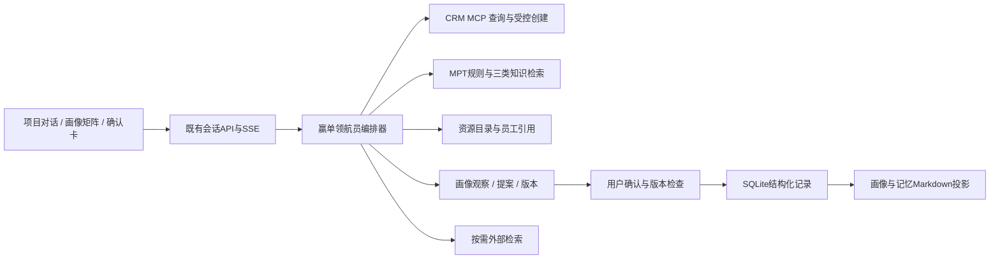

# 赢单领航员：产品设计与落地实施方案

知识维护方式已简化：按七类模块直接维护知识清单，通过本模块Excel导入更新，自动保留版本并可回退，不采用更新包或审核发布流程。清单字段和书写规范以本版第18节及七份Excel的「填写说明」为准；本文其他数据模型为内部实现规划，不作为业务用户填写要求。

版本：2.0；更新日期：2026-11-01。适用：Sales Buddy 海外储能销售团队。

本版以当前Pencil中的赢单领航员旅程和P10.114–131知识库后台为开发基线，纳入七份Excel、617条知识、55个业务字段。第17–24节补充了最新页面映射、Excel契约、导入版本机制、检索链路、开发任务和验收标准，替代早期仅围绕文档检索的知识维护设想。本次只更新实施计划，不执行系统开发、知识导入或数据迁移。

本次交付为Pencil原型整理及实施设计，没有修改运行中的应用、数据库、个人记忆或CRM记录。本文明确区分现有能力与拟开发能力；不将画布中的成功状态视为接口已经实现。

配套文件：

- 七类Excel内容：`knowledge/navigator/imports/2026-11-01/`，具体文件与字段见第18节。Excel交付对应独立内容PR，不以本文存在代表已导入。
- MPT方法论和此前的策略、画像活动、原型审查文档作为设计依据；字段契约以本版及对应Excel为准。
- 正式设计源：`designs/CRM智能助手vzyh_2026.9.23.pen`。

## 1. 产品定位与业务边界

**赢单领航员**统一承载“项目阶段识别、策略打法、资源建议及项目画像演进”。它围绕一个具体销售项目持续工作，帮助销售回答：项目现在在哪里、最值得推进什么、哪些风险尚未解决、内部可以找谁、哪些新事实需要更新到画像。

“定方向、识风险、递资源”是同一回答的三个业务视角，不做三个互相割裂的聊天机器人，也不要求用户在每次提问前选择模式。

- 定方向：依据M×P位置、独立T采购窗口及真实卡点，给出目标、投入方式与下一里程碑。
- 识风险：区分条件尚未满足、信息未知、资料过期、事实冲突、采购主体变化，指出对推进的实际影响。
- 递资源：说明哪项行动可申请哪些支持、适用前提、需要材料、归口人和联系渠道。

一期以售前推进为重点，兼顾交付、验收和回款。分析与资源推荐不等于融资、报价、交期、投资或排产授权。商务承诺仍由企业现有流程决定。

### 命名与入口

- P10.42及以后的项目画像与推进页面统一显示“赢单领航员”。
- 现有客户级战略咨询可以保留在原战略参谋模块；当需要项目阶段判断时，必须明确选中线索或商机。
- 首页/功能导航提供赢单领航员入口，选择客户后列出其项目；不能把整个客户当作一个MPT项目。
- 历史页面编号保留，页面标题加功能名；本次不重编号、不覆盖已删除原型。

## 2. 依据与已确定的口径

方法论来源为工作区“销售策略”下的两份文件：

- `MPT矩阵生成与销售策略展示.pptx`：4页；第1页定义M×P位置、投入风险色块及T轨迹，第2页定义事实、建议、申报与核验，第3页定义采购事件，第4页定义模糊拜访追问。
- `MPT销售策略Agent整体训练规则与交互工作底稿(2)(1).xlsx`：00—15共16张工作表，覆盖M首访问题、P0核真、P1接触、P2/P3教练、P4/P5锁定、收入与采购并行、项目转售、采购主体、规则、交互输出、训练案例及36格策略。

采用此前已读取的完整文本提取与现有方法论分析，按工作表/幻灯片定位原规则，不修改原始资料。

已确认的产品口径：

1. CRM S0为线索，S1起为商机。M/P/T是独立画像，不自动转换CRM实体或修改S阶段；已有商机允许P0。
2. M是项目落地成熟度，P是我方在指定决策主体/采购范围中的位置，T是独立设备采购事件阶段，三者不要求同步变化。
3. M1×P4/P5的SED规则、E0—E3的完整等级定义待业务补充。系统保留事实和人工说明，不自动定级或编造升级规则。
4. AI建议不直接替换正式画像。新阶段必需条件核对后，由用户确认；管理核验与销售确认分别记录。
5. 融资尚未落实不单独排除M3。M3是围绕可融资收入、预算、合同、采购及风险分配推进，不等于融资已经关闭。

## 3. 现有架构评估：可以复用什么

以下结论来自当前仓库代码，而不是仅沿用早期架构文档：

### 前端

- `apps/web/src/main.tsx`：应用路由、会话与流式回答等主体界面。
- `ProjectPortraits.tsx`：已有画像列表、16维事实、补充/纠正/确认/停用、版本和Markdown下载。
- `AnswerActions.tsx`、`AnswerContent.tsx`、`EntityDetails.tsx`：可复用回答操作、结构化内容及实体详情。
- `MemoryManager.tsx`：已有个人、客户、项目维度记忆维护。
- `EChartView.tsx`及`packages/visualization.ts`：可复用矩阵、轨迹、结构化表格渲染。

### 后端与数据

- Express/TypeScript承载应用API及`/mcp`；React/Vite前端共用应用服务。
- `db.ts`使用SQLite，CRM实体存于带独立主键与类型约束的`records`，应用对象存于`documents`，运行事件存于`events`。
- `agent.ts`已有授权Scope、会话、MCP查询、回答、来源快照及运行阶段；`answer_delta`、`answer_replace`、`run_phase`等事件支撑流式交互。
- `mcp.ts`通过MCP SDK连接本地Streamable HTTP服务；分析时过滤写入工具。
- `crm.ts`已有客户、组织、联系人、项目联系人、线索、商机、两类进展、活动、会议、任务及证据资料查询。
- 写入只支持创建待办、商务活动、线索进展、商机进展，需有效确认令牌。没有通用CRM改阶段接口。
- `web-search.ts`已有Exa检索接入。复用管理员配置，不另存API密钥到知识库或原型。

### 画像、知识和记忆

- `project-portrait.ts`：画像主键为用户×实体；已有观察、冲突、版本检查、Markdown投影及失败投影任务。
- `project-interview.ts`：当前按S0—S8安排待问维度，不是完整M/P/T专项问题状态机。
- `memory-v3.ts`：已有用户、用户×客户、用户×项目的私有记忆和来源约束。
- `knowledge.ts`及`strategic-knowledge.ts`：已有阶段知识、FTS检索和“定方向/识风险/递资源”主题，不能直接当作已具备M×P精确规则检索。
- `inline-followups.ts`与`answer-stream.ts`已支持同轮回答中的追问协议及隐藏控制块；不需要再为追问固定增加一次模型调用。

### 必须补齐的差距

- 没有M/P/T定义、候选/申报/核验、采购主体/轮次、规则版本组成的完整领域模型。
- 现有画像可从用户原话自动记录待核陈述；新增“确认后更新”需要把观察入库和有效画像更新分开，不能继续直接覆盖已确认值。
- 现有草稿确认链路不等于“一键待办”已经可用；要复用授权与令牌，增加明确动作卡、幂等提交及回执。
- 需要内部资源目录、匹配条件、员工引用、COME3.0适配层与反馈记录。最新Excel中的真实联系人和工号为待补充；旧原型的Mock员工不得混入真实资源清单。
- 部分历史规范文件仍描述独立追问或演示模式。后续开发时同步规范文件，以当前代码及本方案为准，不把过期文档重新变成运行行为。

## 4. 系统分层与拟新增模块



建议在现有服务内部增量开发，不另建CRM或独立微服务。新增模块名称为拟定路径：

- `apps/server/src/navigator/orchestrator.ts`：意图识别、上下文组装、流程状态与工具预算。
- `stage-rules.ts`：定义及适用条件检查，规则缺失时明确返回待补。
- `assessment.ts`：首次评估、逐题追问、暂存与恢复。
- `portrait-proposals.ts`：差异提案、用户确认、版本冲突及历史事件。
- `strategy.ts`：M×P策略、T窗口、未知事项和投入建议合成。
- `resources.ts`：按能力、地区、阶段、条件和权限匹配资源。
- `task-actions.ts`：将已授权行动复用现有草稿/创建执行链路。
- `come-adapter.ts`：Mock与真实协议切换，不硬编码人员链接。
- 前端新增`NavigatorWorkspace`、`NavigatorAssessmentCard`、`NavigatorPortraitPanel`、`NavigatorMatrix`、`NavigatorChangeReview`、`NavigatorResourceCard`等组件；共享既有会话和实体详情。

## 5. 用户旅程一：首次项目评估

入口判断依据是是否有完整有效的MPT评估，不是项目创建时间。历史很久的商机也可能是未评估项目。

1. 用户进入项目对话。系统授权并读取客户、线索/商机、关联事实与已有画像。
2. 未评估时显示P10.48“开始评估”，说明M/P/T含义及可以暂存。
3. P10.52先选M自评，选项附定义，不提供“让Agent帮我判断”的快捷选项。
4. Agent利用已有事实逐项核实该M阶段最关键的条件。单轮优先一个问题，必要时不超过三个。
5. 选项卡提供状态与解释，允许补充原话；选中不等于提交，用户点击下一步后记录。
6. 问题结束后展示本维度结果：符合、不完全符合、信息不足或冲突，分别说明理由；用户可修改或保存该维度草稿。
7. 按相同模式完成P及独立T评估；P额外识别采购主体与实际支持行为，T额外识别设备采购用途、轮次及日期。
8. P10.57汇总三维结果、依据来源、未知及未满足条件。最终确认后建立销售申报画像，进入P10.42。

未回答全部问题不能显示“追问已完成”。无法确认时允许未知、暂存、继续讨论，不用反复追问同一问题强迫升级。首次评估只暂存维度结果，全部确认前不把不完整草稿伪装为完整画像。

## 6. 用户旅程二：已有画像的整体分析

1. 用户进入P10.42，看到当前M:P、T阶段及重点事项；中间仍为自然对话。
2. 用户请求整体分析报告。系统读取当前画像版本、规则版本、相关CRM实体与最近进展；按需检索外部信息。
3. 处理状态依次显示“读取项目资料、核对画像与阶段、整理行动与资源、生成回答”；不能在生成阶段一直显示MCP查询。
4. 正文流式输出P10.95：结论、影响推进的原因、优先行动、可协调资源和必要追问。
5. 默认约1000字，可执行行动最多8项，默认优先3项。详细来源置于右侧，不重复铺证据表。
6. 右侧来源只统计实际读到的去重记录；打开项目来源清单后可查看对应实体详情。
7. 继续讨论问题来自本轮问题、项目状态及本轮回答，同轮输出完整文本；点击只填入输入框，不自动发送。

无法完整读取CRM时仍可基于已有信息回答，但标记缺失范围。没有外部检索结果时不得编造新闻；旧回答、公开报道与Mock字段均不能替代当前项目事实确认。

## 7. 用户旅程三：行动、资源与沟通

### 从行动创建待办

行动卡显示目标、具体动作与预期产出；绿色“＋ 添加待办”沿用P10.42紧凑样式。用户明确点击创建后，带入当前项目与当前用户，调用既有受控创建链路，成功展示P10.96。

建议默认当前用户为负责人；截止时间应来自本次已明确的行动或用户设置，不能凭空当作客户承诺。缺少必填项时进入P10.111补齐，创建后可编辑。一次点击只提交所选行动，不把整个分析报告转成多个任务。

行动已存在时显示已有待办，而不是重复创建。失败保留卡片及重试，幂等键保持不变；实际CRM返回任务ID后才显示成功。

### 资源推荐与联系

P10.95先说明适用的资源能力。用户追问如何联系，P10.98给出已核实的员工卡、工号、归口、支持边界、材料及渠道；未知归口显示待确认。当前Excel没有真实员工资料，默认只呈现资源支持事项和待补状态，隐藏可执行的联系入口。旧Mock员工仅用于明确标识的开发测试夹具，不进入实际运行目录。

点击员工卡或COME3.0按钮打开对应同事，P10.100展示可编辑沟通摘要。摘要包括项目、当前阶段、具体卡点、希望支持的结果及准备资料。打开不自动发送，不自动共享所有CRM记录。当前先Mock，真实协议后续由企业提供。

金融例子：开发商未落实投资商时，先明确缺口及项目融资准备度，再请供应链金融窗口初筛与协调；不能把“内部有金融资源”当成本项目融资必获批。

## 8. 用户旅程四：基于对话更新画像

1. 用户补充新事实，可以继续自然讨论；后台将可追溯观察暂存，但不直接覆盖有效阶段和已确认事项。
2. 用户说“基于刚刚的对话更新画像”，Agent以当前会话范围和最新版本整理提案。也可在有重要变化时提示是否查看提案，但不自动提交。
3. 提案包括M/P/T原值与建议值、事项标签与描述前后差异、理由、原话/记录引用及保留未知。
4. 受影响阶段的必需问题不完整时，先回P10.108继续追问；已有可靠答案不机械重问。
5. P10.106最终确认，可修改、剔除某项变更或暂不更新。纯事项更新允许M/P/T都不变。
6. 用户确认后以版本号提交，原子保存阶段、事项及事件。P10.110显示结果，侧栏与矩阵使用同一最新版本。
7. Markdown投影失败时结构化记录仍有效，显示后台同步状态并重试，不回退已提交业务事务。

“更新项目阶段”有两个入口：P10.42→P10.113、P10.43→P10.107。阶段选择只是候选，保存选择后仍需对话核对与最终确认。选格查看策略不改变当前位置。

## 9. 界面功能清单

### P10.42 项目工作区

- 项目/客户上下文、个人会话历史、项目切换。
- 流式回答、加载/取消/失败恢复、完整追问带入输入框。
- 轻量行动卡与紧凑添加待办；不增加多段顶部流程导航。
- 侧栏M:P卡、独立T卡、查看画像、更新阶段。
- 当前阶段重点事项：已确认、未明确、不涉及及准确描述。
- 本轮数据来源及实体弹窗；左侧会话工作台按需展开。

### P10.43 项目矩阵

- 6×6坐标、当前点、历史点、T事件及日期。
- 六种背景色图例，分开表达投入与风险，不把暖色当成成交概率。
- 推荐推进方向使用已有动效；减少动效时以静态箭头和目标高亮替代。
- 选格查看策略、返回对话生成分析、修改阶段进入描述弹窗。
- 当前申报/核验/AI建议分层显示，未知坐标不能默认为M0/P0。

### P10.48、52、55、56与阶段专项页

- 未评估说明、开始/暂存/恢复。
- 附定义的阶段卡、自评选择、问答选项、补充文本、上一题/下一题。
- M0—M5、P0—P5、T0—T5各自专项问题；条件性分支由问题包决定。
- 完成后才给符合性判断，用户可修改或保存维度草稿。

### P10.57、58

- 汇总三维、保留未知、建立画像、返回修改。
- 随时重新评估；对照旧版本，受影响维度重新核对，未受影响维度复用有效事实。

### P10.95、96、98、100

- 综合分析报告、三类策略与资源。
- 单条待办创建状态及回执、后续编辑。
- 资源按适用性排序、联系人、材料、知识库依据、COME入口。
- 对接摘要编辑与附件选择；不自动发送。

### P10.105—111、113

- 来源实体清单、记录详情、范围和读取失败状态。
- 统一画像修改提案、按字段选择确认、版本冲突提示。
- M/P/T描述弹窗、候选保存、对话追问、最终确认。
- 更新后阶段及事项同步刷新、版本记录。
- 待办草稿/创建后编辑。功能清单不是要求每种数据都复制一个页面。

## 10. 核心数据对象

建议一期继续使用现有应用对象存储，生产化再按查询量评估专表。不要将所有信息塞入一个Memory.md再让模型自行解析。

### ProjectIdentity

`projectKey`为应用内逻辑引用，绑定`entityType + entityId + customerId`。线索和商机仍为不同CRM实体。转化时记录明确映射，保留历史来源；访问原线索和新商机都重新授权，不能仅凭相同名称合并画像。

### MptAssessment

- ID、用户、项目、规则版本、基准画像版本。
- 每维自评、候选、销售申报、管理核验、核验时间及适用范围。
- 状态：draft、questioning、review、completed、cancelled。
- 题目与答案引用、已问/已答/待核、跳过原因、恢复游标。

### StagePosition

- M/P/T各自独立值，不用单个stage字段替代。
- 当前有效值、销售申报值、管理核验值、AI建议值分开保存。
- 只有在核验仍有效且主体/范围未变化时，核验值优先于销售申报；M可按来源规则回看原始值。P/T未知保持未评估。
- 旧核验与新申报冲突时，不静默覆盖；显示待复核。重新授权核验后才改变管理位置。

### ProcurementContext

- 当前采购主体、角色模式：业主直采、EPC代采、多方审批等。
- 设备供货范围、采购轮次、T事件及发生日期。
- 用途：预算测算、方案比较、正式采购等。
- 活跃/暂停/回退/重招/终止状态，与T阶段分开。
- P绑定采购主体和范围；转售/更换EPC后不自动继承。

### PortraitFact与StageCheckpoint

- 事项定义ID、适用M/P/T、描述、业务状态、来源与时间。
- 适用性：适用、不涉及、尚未明确；不涉及需原因和复核条件。
- 信息确认：未知、销售陈述、销售确认、专业核验、冲突。
- 业务状态：未启动、申请中、受理、附条件获批、批准、已签署、已落实等按事项类型选择。
- 显示标签“已确认”只代表信息确认；不能把“已确认：审批办理中”当成“审批完成”。
- 原话、来源消息或CRM引用、有效期、责任人、下一节点、关联风险。

### ChangeProposal与ChangeEvent

- 提案绑定基准版本、会话/消息范围、规则版本，存候选阶段及逐字段前后差异。
- 状态：needs_questions、ready_for_review、confirmed、cancelled、stale。
- 确认人与时间、选中变更、未选理由、幂等键；事件保留所有原值。

### ActionSuggestion与ResourceMatch

- 行动ID、目标维度、适用阶段、动作、对象、产出、关闭标准、负责人/日期的确定状态、源回答。
- 已关联待办ID及创建状态，防止同义任务反复创建。
- 资源项ID、版本、匹配理由、前提是否满足、归口员工引用、材料与可用性核实时间。

## 11. 记忆与画像机制

### 三层内容分开

1. 用户Memory：角色、地区、表达偏好等用户自己表达的特点，按日期更新；不保存系统提示词。
2. 用户×客户/用户×项目Memory：关注主题、常问问题、沟通偏好和历史摘要。
3. 项目画像：阶段性业务事实、关键活动、风险、采购主体、资源协同和MPT版本，作为后续推理的状态来源。

一期沿用现有用户×项目权限；用户查看自己的，管理员按权限查看所有人的。若后续提供团队共享画像，需增加明确发布与项目角色授权，不能把私有记忆直接拼成团队事实。

### 写入流程

真实用户消息→提取原话与项目归属→形成观察→去重与冲突检查→候选变更→必要追问→用户确认→有效画像版本→Markdown投影。

用户提问、假设、AI建议、点击后尚未发送的问题，不是项目事实。旧陈述不会仅因新时间戳就覆盖已确认相反信息。明确“这个内容不对”应形成纠正记录并追溯旧值。

建议投影结构：

```text
# 项目画像
## 当前定位
## M：落地条件与重点事项
## P：决策主体、关系与行为
## T：设备采购轮次与事件
## 当前风险与未知
## 下一里程碑及行动
## 已申请资源与反馈
## 按日期的确认变更摘要
```

结构化数据库是事实源，MD可读可导出；不能手工改MD后绕过权限、确认与版本直接影响阶段。

### 下次对话如何使用

优先加载最新有效画像摘要、当前问题相关事实、近期变更、未知/冲突/过期事项。历史全文按需检索，避免把全部会话反复塞入模型。若已确认事项过期，只提示复核，不立即退级。

## 12. 知识库与Agent编排

详细内容见配套知识库设计。实现时采用规则与检索结合：

- 硬规则：Scope授权、阶段枚举、主体绑定、规则待补、确认与写入闸门。
- 知识检索：M问题包、P打法、T采购窗口、M×P单元格、三类专题与地区/模式差异。
- 模型职责：理解口述、识别缺口、提问、解释判断、生成行动与资源适配理由。
- 规则检查器验证模型输出：无支持来源的阶段升级、未知规则自动补齐、跨项目引用和虚构联系人均不可通过。

建议业务输出结构独立于展示文本：`stageAnalysis`、`questions`、`actions`、`resourceMatches`、`portraitProposal`、`sourceRefs`。正文和上下文追问同轮生成；控制字段不直接渲染为正文。

用户继续讨论不需要预设所有场景Prompt。使用统一角色规范、意图路由、可组合知识条目与受控工具。只有明确创建行动带工具能力映射，不能让模型自由生成不存在的按钮或接口。

## 13. 拟新增API与执行边界

以下为设计接口，不是当前已存在接口：

- `POST /api/navigator/assessments`：启动/恢复某项目评估。
- `POST /api/navigator/assessments/:id/answers`：提交回答及版本，返回下一题或结果。
- `POST /api/navigator/assessments/:id/confirm`：保存完整首次画像。
- `GET /api/navigator/projects/:key/portrait`：返回有效画像、申报/核验与候选差异。
- `POST /api/navigator/projects/:key/proposals`：根据指定会话消息范围整理变更。
- `POST /api/navigator/proposals/:id/confirm`：版本校验、幂等及原子保存。
- `GET /api/navigator/resources`：按问题、阶段与权限查询资源。
- `POST /api/navigator/actions/:id/create-task`：显式创建授权，复用现有CRM确认令牌与执行器。
- `POST /api/navigator/resources/:id/handoff`：生成所选员工的沟通摘要或Mock入口。

现有会话API、SSE、来源与实体详情继续复用。MPT更新是应用内画像更新，不通过不存在的CRM“更新商机阶段”MCP操作实现。未来若CRM增加写接口，再单独设计审批和同步。

## 14. 逐步开发与交付

### 阶段A：规则、知识和数据契约

沉淀18阶段问题包、36格策略、采购主体/转售规则、资源字段和画像Schema。建立规则版本及业务待确认清单。完成输入输出类型与不改用户数据的迁移方案。

验收：各阶段定义能追溯原资料；未知规则有显式状态；CRM阶段和MPT无自动绑定。

### 阶段B：首次评估及画像确认

实现问答状态机、阶段符合性判断、暂存恢复、提案确认、版本记录及MD投影。将既有自动提取改为观察层，保护已确认内容。

验收：18阶段问题均有覆盖；未知/冲突不被强迫升级；中途离开可恢复。

### 阶段C：持续分析、策略及流式交互

集成CRM关联检索、三类知识、同轮追问与MPT矩阵。统一加载状态与正文流式输出，完成作用域、取消和部分失败处理。

验收：Coventry完整旅程与项目切换正确；右侧版本、报告来源和矩阵一致。

### 阶段D：行动与资源闭环

实现幂等一键待办、编辑回执、资源匹配、联系人缺失降级、COME摘要及协同结果回流。开发测试可使用隔离的Mock目录，真实COME协议及企业资源资料到位后启用实际联系入口。

验收：一条行动一个待办；打开同事不发消息；资源信息未知时不虚构。

### 阶段E：企业试点与业务验证

接入实际目录与权限，核实国家差异、M2适用清单、M3融资准备标准、早期P4/P5及核验权限。选择少量销售与实际项目复盘后再扩大，不用自动化通过率替代业务认可。此处是业务质量验证，不是知识库审核发布流程。

每阶段独立任务分支、PR、测试与回滚方案；未经用户授权不合并或发布。没有模型服务信息、企业目录或规则批准时，可继续Mock验证，不宣称真实集成完成。

## 15. 验证清单

- M：旧公告时间差、并网受理/批准、核心RTB/融资关闭、M3未融资但已投资级推进、NTP条件、建设后的剩余范围。
- P：友好/不反对不等于教练、头衔不等于权限、口头优选不等于书面锁定、转售不继承、EPC变更需复核。
- T：预算RFQ仍为T2、PPA不变设备T、跳步、暂停、回退、重招新轮次。
- 权限：当前用户、跨客户、同客户不同项目、管理员只读他人私有画像、资源目录受限字段。
- 更新：未确认不写有效值、部分事项更新、原子保存、重复确认、并发版本冲突、过期提案、MD投影失败。
- 创建：意图明确、缺字段补齐、幂等、重复任务、部分失败、超时后查回执。
- UI：长历史、长报告、长选项、流式取消、错误重试、减少动效、窄窗口和中文标签换行。

复用现有单元与Playwright工程，新增领域规则测试、跨模块集成测试和浏览器核心旅程。开发后按AGENTS运行相关测试、`npm run test:ci`、`npm run build`及密钥检查；本次设计不声称这些业务测试已运行。

## 16. 业务方需要准备的材料

- 方法论负责人：阶段定义、必问/条件问、完成标准、例外、待补SED/E等级及审核版本。
- 销售运营：采购主体模式、转售/重招案例、决策链样例、角色权限口径与典型成功/失败项目。
- 开发/工程/当地专业方：各市场核心RTB适用清单、许可/并网证据与状态名称。
- 金融/投资：支持范围、资金缺口分类、Bankability资料、申请条件、归口人和不可承诺项。
- 产品/售前/交付：产品版本、技术包、经济性模型输入、交付/服务能力、区域限制与资料使用级别。
- HR/IT/资源维护人：员工ID、工号、姓名、岗位、地区、COME映射及目录更新时间。
- 关系维护人：供应商/EPC/投资人关系的真实依据、维护人、用途授权、最近核实时间；无真实关系时明确空缺。
- 权限与业务管理：谁可申报、谁可核验、谁能发布共享画像、历史如何保留。

真实客户资料与私有材料进入受控运行目录，不提交Git；仓库只存脱敏样例、Schema、原创方法论与获准公开的知识模板。

## 17. 最新原型到开发功能的映射

### 17.1 销售端：围绕项目完成一个闭环

- **P10.48 未评估入口**：是否首次评估由有效MPT评估记录决定，不能看项目创建时间或CRM的S阶段。允许开始、暂存、恢复；不在后台偷跑一轮评估后直接给项目定级。
- **M、P、T专项问题页及P10.57汇总**：按M→P→T顺序自评；阶段选项带定义，常规问题用问答选项卡呈现。M所选阶段改变必问内容，P核决策主体和支持行为，T核采购范围、用途与轮次。每维问完才给判断与理由，用户决定修改或保存；不提供“不清楚？让Agent帮我判断”按钮。自然语言中仍允许用户表示不知道。
- **P10.42 项目对话主界面**：中间是流式对话，右侧是当前M:P卡、独立T卡、查看项目画像、更新项目阶段、阶段重点事项和本轮数据来源。左侧工作台默认收起。顶部不再叠加“阶段分析/推进方案”流程条，不恢复“查看全部来源”“生成完整推进方案”按钮。
- **P10.43 矩阵**：6×6位置、当前位置、历史轨迹、色块含义；M图例置于矩阵下方。T1–T5放大，以中轴线串联并带阶段描述；T0保留“未启动”状态入口，不伪装为T1。推进方向以箭头动效表达，减少动态效果时提供静态替代。查看策略和修改阶段是不同操作。
- **P10.95 整体报告**：综合项目画像、客户、联系人、组织决策链、线索/商机、各自进展、商务活动、会议及按需外部资讯。先给相关结论，再给行动、风险和可协调资源，避免证据堆砌。每条可执行行动最多一个紧凑绿色“＋ 添加待办”。
- **P10.96 / 111 行动落地**：字段齐全时显式点击即可按授权创建；缺少负责人、日期等实际必填值时补齐草稿。重复点击、网络超时、重试使用同一幂等标识。以CRM回执决定成功状态。
- **P10.98 / 100 递资源**：解释谁能帮助、为什么适用、前提和准备材料。联系人已验证才显示姓名/工号卡及COME入口；当前Excel待补项不能生成可联系员工。打开会话或编辑对接摘要不等于代用户发消息。
- **P10.105 数据来源**：只展示本轮实际读取、已授权且与当前项目有关的记录，点击弹窗查看业务详情；不用JSON作为最终面客界面。外部报道和CRM数据分开，未检索即不显示“已引用”。
- **P10.107 / 113 修改阶段**：矩阵入口与主对话入口使用同一描述选项弹窗。显示当前阶段，各选项内带定义；不显示多余的“候选M2:P3/T2”文字区域。保存选择只进入待核对话。
- **P10.108 / 106 / 110 画像更新**：按新阶段所需事项追问，整理阶段和事项的前后差异，允许逐项选择、修改、取消，最终确认后才更新有效版本。事项状态和描述可以单独变化，不要求同时升级阶段。

### 17.2 管理端：七类模块共用维护流程

- **P10.114 模块入口**：七个模块及当前条数，合计617条；入口显示来源内容版日期和本模块操作。
- **P10.115–121 列表**：依次为阶段定义、判断规则、画像活动、追问、M×P、风险、资源。表头逐列与Excel一致，不合并“所属维度/阶段”。支持模块切换、搜索、适用阶段筛选、分页、下载模板、导出清单、导入Excel、查看版本。
- **P10.125–131 完整内容**：对应上述七类列表，点击记录打开统一抽屉，按Excel列序左右排列字段，显示全部原文，关闭后回到原模块、筛选和页码。原型预览每页2条；实现应支持每页2/10/20条，默认与原型一致。原型仅画首两条，不代表系统只存两条。
- **P10.122 导入**：明确当前模块、文件名、记录数、完整替换方式、字段说明；只接收该模块的.xlsx。
- **P10.123 确认**：沿用对应模块的全部原始列，查看完整内容；显示新增、修改、移除、不变的对比与字段错误。不能只展示合并后的三列摘要。
- **P10.124 版本与回退**：本模块历史清单、下载、查看差异、恢复确认；恢复形成新版本，旧版本保留。只回退知识，不回退项目画像、会话、待办和CRM记录。

七类列表的55个业务字段、预览原文和总条数已经在设计中与实际Excel核对。本次开发应以实际文件为输入做自动化契约检查，不手抄一套前端固定列表。原型中的分页与点击标注仍需开发实现。

## 18. 七类知识库的导入契约

### 18.1 共通要求

每个模块一份Excel，工作表只有「知识清单」「填写说明」。导入读取「知识清单」，首行为列名，第二行起一行一条知识；「填写说明」用于人阅读。列表、详情、模板、导出、导入预览共用一份字段配置，不能分别维护五套列名。

表头使用以下原文及顺序，不加星号或稳定ID，不引用PPT文件。后台可以有自己的标识与解析字段，但不得要求用户填写。必填、格式、示例和书写规范依据对应Excel「填写说明」展示。

### 18.2 文件、字段及消费位置

**01_阶段定义.xlsx：18条，6列。**

所属维度、阶段、阶段名称、阶段说明、判断要点、常见误判。

用于阶段选择卡、定义解释和符合性判断。M/P/T各6个阶段；维度与阶段必须对应。规则缺口不能用模型生成的定义补齐。

**02_阶段判断规则.xlsx：46条，8列。**

规则名称、适用维度、目标阶段、适用条件、应确认事项、判定标准、信息不足时如何追问、例外说明。

用于判断适用性、核对阶段及处理转售、预算询价、重招、主体变化等例外。适用维度允许组合，但不代表M/P/T同步升降。

**03_画像事项与活动.xlsx：156条，8列。**

活动名称、适用阶段、活动目的、具体动作、找谁开展、需准备资料、应形成结果、完成判定。

用于重点事项、推进动作、待办草稿和完成标准。当前清单同时包含状态核实事项与推进活动，不是一行一个法律审批项；上线前需做业务映射，不能把156行全部铺到每个项目侧栏。侧栏只显示当前维度、阶段、模式实际适用的事项，详细活动用于行动推荐。

**04_追问问题.xlsx：199条，7列。**

问题名称、适用阶段、什么时候问、问题内容、选项与含义、不同答案如何追问、什么时候结束。

用于问答卡、答案分支、何时结束和避免重复提问。文案由Agent结合当前事实表达，问题包提供业务约束；不把已明确事实重新问一遍，也不把“未明确”理解为业务条件不成立。

**05_M×P策略.xlsx：36条，8列。**

M阶段、P阶段、当前目标、投入建议、关键动作、风险提醒、可寻求资源、下一里程碑。

用于矩阵格子和当前推进建议。每个组合唯一。T作为独立采购背景修正动作，不把36格扩大成未经定义的216个固定策略。M1×P4/P5明确规则待补。

**06_风险规则.xlsx：122条，7列。**

风险名称、适用阶段、触发信号、可能影响、需要核实的问题、应对动作、解除或关闭标准。

用于发现未知、冲突、成熟度误判及履约风险。知识存在不代表项目触发了风险，必须说明匹配到的当前事实或尚缺什么。解除标准未满足时不得随知识回退自动关闭项目风险。

**07_资源能力与联系.xlsx：40条，11列。**

资源名称、资源类别、适用地区、适用阶段、能支持什么、使用前提、准备资料、对接部门、联系人姓名、工号、联系渠道。

用于按阶段和问题匹配内部支持，涵盖信息、专业能力、供应链金融、投资引荐、供应商交集、接待、政府及交付服务等。当前40条是资源需求和建议能力清单，不是已验证的企业服务目录。待补联系人保留为文本，不解析成有效员工，不生成COME链接；不能将“建议归口”展示成实际部门承诺。

### 18.3 三类业务知识与七类模块的关系

“定方向、识风险、递资源”是回答的业务视角，七类模块是知识组织和维护方式，两者并非一对一。

- 定方向主要调用阶段定义、判断规则、M×P策略、画像活动和追问。
- 识风险主要调用风险规则，同时用阶段定义和判断规则核验触发条件，再用活动和追问给出缓解办法。
- 递资源主要调用资源能力与联系，结合策略、活动和风险说明为什么需要支持、什么条件下申请。
- 一条活动可能同时服务三类目标。分类由后台内部解析或维护映射，不给Excel加用户未要求的技术列。
- 地区和模式从客户/项目上下文匹配。知识没有覆盖某国家时保留通用建议并明确待核事项，不补造当地许可、融资或政策结论。

## 19. 知识后台的系统实现方案

### 19.1 前端组件与页面状态

在现有React应用增加模块化的知识管理工作区，可复用 `KnowledgeLibrary.tsx` 的入口与已有权限导航，但不要直接将现有只读文档页面改成无权限写入口。

拟新增共享组件：`KnowledgeModuleCatalog`、`KnowledgeRecordTable`、`KnowledgeRecordDrawer`、`KnowledgeImportDialog`、`KnowledgeImportReview`、`KnowledgeVersionHistory`。组件名为建议，开发时按目录规范调整。

模块字段配置包含业务列名、顺序、必填、宽度、长文本展示及说明。列表不增加知识字段；选择框、查看操作和分页属于界面控件。长字段保留原文，列表可折叠并显示省略号，抽屉不得截断。切换模块时切换对应字段和记录，不共用上个模块的缓存结果。

数据量按服务端搜索分页加载，不能用原型中的前两条硬编码数据替代。清单的下载结果应对应明确模块版本；筛选后导出需清楚标注筛选范围，默认“导出清单”导出该模块完整当前版本，避免把筛选子集误导入替换。

状态至少包含加载中、无记录、无匹配、无权限、读取失败、导入检查中、检查失败、待确认、提交中、提交成功和版本冲突。失败不得清空当前有效知识。

### 19.2 导入及确认事务

1. 管理员选定模块、上传.xlsx。限制文件大小、解压体积、行列数；不执行公式、宏或外部链接，不把公式缓存结果当知识文本。模板正文均为文本，可按文本解析；错误指出Excel行号和字段。
2. 检查工作表、表头原文与顺序、必填、空行、重复业务键及维度阶段。仅忽略尾部空白行，不静默吞掉中间缺少字段的记录。
3. 阶段定义以“所属维度+阶段”、策略以“M阶段+P阶段”做业务对比，其余模块以模块内规范化名称匹配。名称变化表现为新增和移除，界面解释清楚；不用模糊匹配偷偷合并。
4. 空清单、缺少18阶段/36策略组合、重复键、非法枚举和冲突定义要阻止提交并给出修正位置。原资料中的待补规则是明确业务状态，不当成缺少定义去自动补写。
5. 与当前版本比较，展示新增/修改/移除/不变；移除明确列出。用户可以返回改Excel或确认完整替换；不增加审核、审批、发布环节。
6. 确认令牌绑定文件摘要、模块、解析结果和基准版本。重复确认返回同一结果；当前版本变化时重新对比，不覆盖其他管理员更新。
7. 新版本的原始行、内部结构映射、检索索引全部准备成功后，再在事务中切换当前版本；失败保持旧版。前端不得先显示成功再后台慢慢补必需索引。
8. 导入范围仅本模块。不覆盖其他六模块，不写客户/项目画像，不重置本地用户数据；保留旧Excel、旧清单、变更摘要和操作者时间供查看与回退。

### 19.3 版本与回退

版本号由系统生成；业务用户无需填写。查看历史时明确“历史内容”，不与当前版混用。恢复旧清单时显示目标版本、差异和本模块影响，确认后复制旧内容形成新的当前版本；不删除回退前版本。

单模块回退需检查跨模块兼容性，例如活动引用的阶段仍存在。遇到不兼容阻止切换并说明依赖；不要自动回退其他模块。运行中的回答固定使用启动时的知识版本集合，下一轮再使用更新后的集合，避免一段回答混入新旧规则。

### 19.4 内部存储与索引

一期可沿用SQLite和应用对象机制，建议新增以下逻辑集合或专表；这是内部设计，不能暴露成Excel填写列。

- `navigator_kb_modules`：模块、字段配置版本、当前知识版本。
- `navigator_kb_versions`：模块、版本、文件摘要、行数、操作人、时间、变更摘要、恢复来源。
- `navigator_kb_rows`：版本内行序、业务键、原始业务字段对象、内部规范化结果和解析提示。
- `navigator_kb_imports`：导入检查记录、临时文件引用、基准版本、有效期、错误与确认幂等信息。
- `navigator_kb_indexes`：版本绑定的阶段、地区、模式、主题、关键词检索结果；可用FTS，不强制一期引入向量库。
- `navigator_kb_usage`：回答/评估使用了哪些模块版本及条目引用，便于复盘而非展示大量证据。

现有 `knowledge.ts` 的初始化和 `reindex()` 会重建旧文档库。新模块必须使用独立持久化命名空间，启动时不能把管理员导入版本又覆盖成仓库基线。旧知识与新知识在检索适配层组合，不共用会被全量删除的索引表。知识导入文件与运行时版本放受控运行目录，仓库只保留脱敏基线Excel与配置。

## 20. Agent如何调用新知识并生成推进建议

### 20.1 一轮对话的建议执行顺序

1. 确认用户和项目Scope；客户级问题未明确项目时先选择项目，不聚合客户下不同商机的阶段。
2. 固定当前有效画像、MPT评估、采购主体/范围/轮次和七模块当前版本集合。
3. 读取该项目授权CRM记录及本轮需要的外部资讯，形成事实摘要；内外部资讯不成为知识库维护资料的替代物。
4. 对已知M/P/T精确取阶段定义和适用规则；M/P齐全时精确取一个M×P组合。未知则走评估和核实，不默认M0:P0。
5. 依据当前阶段、项目模式、地区、卡点检索活动和风险；由规则确认风险触发证据。对适用性不确定的条目先问，不直接下结论。
6. 从问题库选取未回答、影响当前推进的重要问题，优先一题；结合用户原话补充分支，已有可靠答案跳过。选择“未知”可以形成待核活动并继续。
7. 根据所选行动匹配资源的阶段、地区、前提、归口与资料。匹配不到联系人时返回缺失状态，不让模型自由生成姓名、工号和链接。
8. 同一回答输出正文、继续讨论问题和结构化行动/资源；UI分开展示文本、提问按钮与创建按钮。点击追问只填输入框，由用户发送。
9. 从真实用户陈述提取观察，用户要求更新时汇总提案。提案涉及新阶段时补齐关键问题，再由用户确认。

检索排序优先：精确项目情境和适用阶段→明确业务条件→地区与模式→关键词相关性。阶段定义、授权闸门和确认条件不依赖关键词打分。对有歧义的自然语言条件由模型解释，条件是否满足保留依据和待核状态，不将全部文本直接编译成自动升阶段规则。

### 20.2 统一回答与输出契约

默认正文约1000字，根据问题适当伸缩；行动不超过8个，优先3个。顺序为“核心判断→与提问有关的关键问题→可执行行动→必要资源与追问”。数据整理建议与主问题无关时放末尾或省略。

建议结构化字段：`summary`、`stageAnalysis`、`riskFindings`、`actions`、`resourceMatches`、`followupQuestions`、`portraitProposal`、`sourceRefs`、`knowledgeRefs`。阶段判断、问题和资源须带内部引用，UI不直接铺满证据。

动作类型使用受控枚举：讨论问题、生成建议、创建待办、创建商务活动、创建进展、查看实体、查看画像、提出画像更新。模型不能生成任意工具名或按钮执行代码。“整理下一步待办”“准备商务活动”属于汇总规划，只有明确创建按钮才进入创建链路。

可复用同轮输出追问协议，不能为每次上下文追问再固定启动一次独立模型请求；CRM工具调用和必要的质量校验可以有独立步骤，但应分别记录耗时并展示准确状态。

### 20.3 知识更新对画像与对话的影响

- 已完成评估保留当时规则版本和用户确认，不因知识更新自动失效或改级。
- 下一次对话若新规则与当前画像相关，可提示“判断规则已更新，是否复核相关事项”，形成新评估或提案，不能静默覆盖。
- 进行中的评估固定版本；完成前如管理员切换规则，提示继续当前版本或另建复核，保留已答内容及来源，不把旧答案当新规则已确认。
- MD仅为结构化画像的可读投影。知识导入/回退不直接重写Memory.md或ProjectProfile.md。
- 回答来源同时可追溯CRM记录快照与知识版本，两类引用不可混为“客户已确认”。

## 21. 增量数据和接口开发任务

### 21.1 画像与评估模型补充

保留第10节的事实/观察/提案/事件划分，落实以下约束：

- M/P/T按维度独立存储，P和T带采购主体、供货范围、采购轮次。阶段可未知，不用缺省0替代。
- 画像重点事项同时保存信息确认标签和业务进度，例如“已确认：并网已受理，尚未批准”。“已确认”不是完成审批的勾选。
- 事项定义与知识版本关联，项目实例记录其状态、描述、来源、责任人、时间、适用性和不涉及原因。
- 活动知识用于生成项目实例，不直接把模板行当已做过的活动。实例与CRM任务、商务活动、进展分别关联，不混为一个实体。
- 当前 `applyPortraitUpdates()` 可将销售陈述写入画像字段。开发必须先改为观察暂存；有效画像更新统一走提案确认，迁移时不将历史陈述批量升级成已确认。
- 用户×项目的事实权限沿用现有边界；管理员可按权限查看，不代表可以代替销售确认私人画像。
- 每次确认以基准画像版本和规则版本校验，原子写入阶段、事项、事件；重复提交不产生第二次更新。

### 21.2 拟新增知识管理接口

下列路径为拟定设计，开发时按既有路由风格调整，不表示已经实现：

- `GET /api/admin/navigator-knowledge/modules`：模块、字段说明、版本、数量。
- `GET /api/admin/navigator-knowledge/:module/rows`：搜索、阶段筛选、分页、版本选择。
- `GET /api/admin/navigator-knowledge/:module/rows/:rowRef`：该版本记录的全部业务字段。
- `GET /api/admin/navigator-knowledge/:module/template`：该模块Excel模板与填写说明。
- `GET /api/admin/navigator-knowledge/:module/export`：导出明确版本的完整清单。
- `POST /api/admin/navigator-knowledge/:module/imports`：上传解析，返回检查和差异预览。
- `POST /api/admin/navigator-knowledge/imports/:id/confirm`：版本检查、幂等和原子切换。
- `GET /api/admin/navigator-knowledge/:module/versions`：版本列表和详情。
- `POST /api/admin/navigator-knowledge/:module/versions/:version/restore`：确认恢复为新版本。

写接口只给管理员或明确的知识维护角色。销售端通过Agent和受控查询消费知识，不获得导入权限。解析临时文件到期清理；历史版本仍在保留范围内时不能误删其内容和文件。

## 22. 更新后的执行顺序与交付包

以下工作包细化第14节，开发以本节顺序和完成标准为准。每包独立任务分支、PR，不在本次计划更新中执行。

### K0：设计和数据契约固化

完成七模块字段配置、55列映射、18阶段与36格覆盖检查、156活动到侧栏事项/行动的映射、规则待补标记、资源缺失联系人降级及API契约。核对现有CRM数据的客户—项目—进展—活动关联。

交付：类型Schema、字段配置、脱敏知识基线和差异清单。验收：Excel与原型逐列一致；没有额外业务必填技术ID；确认所有前置设计/Excel分支内容已进入开发基线。

### K1：七类知识后台与版本底座

实现P10.114–131对应的模块入口、七列表、完整内容、模板下载、导出、导入检查、差异确认、版本与回退。建立独立持久化和检索索引，防止旧库启动覆盖新内容。

交付：管理员可以完整维护七模块。验收：首次导入617条并重启后数量与内容不变；更新一个模块不改另外六个；回退生成新版本；错误文件不影响有效版本。

### K2：项目画像与确认机制

实现MPT位置、事项实例、采购上下文、观察/提案/有效版本分离，完成现有16维画像的兼容读取和非破坏迁移。

交付：P10.42侧栏、P10.106/110更新确认闭环。验收：未确认不修改有效阶段和事项；纯事项更新不强制阶段变化；冲突可回到对话核实；MD失败可重试。

### K3：首次评估与重新评估

实现阶段定义选项、M/P/T专项问答、条件分支、暂停恢复、单维结果与三维汇总；阶段修改两入口复用同一流程。

交付：P10.48至汇总以及P10.107/108/113。验收：18阶段均有适用问题，已答有效事实不重复问；未完成不显示全部追问结束；M1×P4/P5保留待补；重新评估不提前覆盖旧值。

### K4：整体报告、矩阵和持续建议

实现固定版本检索链路、三类策略回答、同轮上下文追问、真实流式事件、准确loading、M×P矩阵和T轨迹、来源实体弹窗。

交付：P10.42/43/95/105及关联对话。验收：报告与侧栏同一画像版本，来源只包含本轮实际读取项；默认约1000字、行动≤8；追问带入输入框、不自动发出；长历史与长回答各自滚动，不顶飞中间区。

### K5：行动与资源闭环

复用现有CRM创建授权链路，完成一键待办、缺字段草稿、幂等与回执、资源匹配和缺失状态。COME先使用隔离Mock适配器验证点击及摘要，不接入虚构真实员工。

交付：P10.96/98/100/111。验收：重复点击只建一个任务；没有真实联系人时不显示可执行联系；打开会话不自动发送；资源匹配解释前提和准备材料。

### K6：迁移、回归与试点

在隔离测试库完成既有数据兼容、重启持久化、异常恢复、权限隔离、模型实际调用验证和代表性销售旅程。保留旧会话、个人记忆和CRM记录；不运行scenario reset作为升级步骤。

交付：迁移脚本、回退说明、验收记录及未完成业务依赖。上线不与本计划授权合并发布等同；待明确执行开发、合并或发布时按相应范围开展。

依赖关系为K0→K1→K2→K3→K4→K5→K6。K1字段契约稳定后可先做列表组件，K2稳定后可做矩阵；资源真实对接资料不齐不阻塞画像和建议验证。工作量需在K0代码评审后估算，不用未经验证的天数承诺。

## 23. 验收、回归与质量样例

### 23.1 知识闭环

- 七份基线分别18/46/156/199/36/122/40条，总617条；55字段无缺失、无拼写变化，导出再导入业务内容一致。
- 阶段和矩阵重复键、必填缺失、错误列序、公式单元格、错误模块、空文件、解压异常均给业务可读提示；不产生部分当前清单。
- 同模块两人并发导入、同令牌重试、版本切换失败、索引失败、应用重启、旧版本导出与恢复均有测试。
- 所有列表/详情/导入预览显示同版本原文；导出完整清单不会偷偷变成当前筛选两条。
- 知识导入及回退后，会话、画像、待办、客户和商机记录数量及有效值不被改写。

### 23.2 Coventry主旅程

1. 选择OP-001，CRM为S1；如果没有有效MPT，则进入评估，不默认采用样例M1:P2/T2。
2. 销售陈述土地已租赁、并网仅受理、许可仍办理，逐题核实，判断M1；联系人支持参与但没有教练行为，核实P2；经济测算RFQ核为T2。
3. 用户确认后建立画像，侧栏准确显示“并网已确认：已受理，尚未批准”。
4. 请求整体分析，给开发节点核实、有效支持验证等行动及适配资源，真实流式生成，最多8个行动。
5. 点击添加待办创建一条；再次点击不重复。联系人未补齐时资源说明待确认，不生成虚拟工号。
6. 用户补充新条件并要求更新，先产生差异和需要补核的问题，再由用户确认，侧栏和矩阵同步新版本。
7. 管理员更新相关知识后，该画像保持原值；下一次对话只提示是否需要复核，历史回答仍能追溯旧规则。

### 23.3 业务反例与模型验证

至少覆盖M3融资未关闭、旧公告与最新动作冲突、P2/P3行为区分、转售不继承P、EPC更换、T5由竞争对手中标、PPA与设备采购并行、暂停不自动退级、重招新轮次、未知及不涉及、同客户多项目隔离。

确定性的字段/权限/版本/规则测试使用固定夹具；在线模型验证用本地已配置服务，不要求演示模式。模型样例评估关注：是否回答主问题、阶段解释是否有依据、是否问关键缺口、行动是否可执行、资源是否真实、是否未经确认写入画像。领域硬约束必须全部满足，模型表达质量由业务样例复盘，不用单一平均分掩盖跨项目泄漏或虚构联系人。

正式开发后执行相关领域测试、集成测试、Playwright核心旅程、`npm run test:ci`、`npm run build`、`npm run security:check`。本次仅文档更新，不声称这些功能测试已通过。

## 24. 业务依赖与本版交付边界

当前可直接开始：字段配置、导入版本底座、617条基线检索、画像确认机制、MPT问答、Mock数据下的分析和待办验证。

需要业务逐步补齐：

- M1×P4/P5 SED规则与E0–E3完整定义；未补前相关功能明确待补，不临时猜测。
- 156条活动中哪些对应长期画像事项、哪些仅为可执行动作，以及各地区/模式适用条件；不把所有通用问题强制问给每个项目。
- 40条资源的实际支持能力、地区限制、申请前提、真实归口、联系人、工号和COME映射；未核实前不启用真实联系。
- 实际项目阶段案例、成功/失败行为、业务可接受的判断标准，以及谁可核验阶段和共享画像的权限。

本版交付为更新后的实施计划。最新原型与Excel是功能和内容依据，原型成功状态不是实现证据。没有执行代码开发、知识导入、数据库迁移、数据重置或正式发布；后续开发按K0–K6逐包交付。
