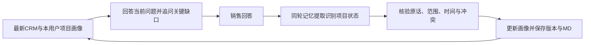

# 项目画像与三类知识库实施说明

日期：2026-10-27。

## 1. 项目记忆升级后的行为

项目画像按“用户 × 具体线索/商机”保存。用户长期偏好、客户经营记忆和项目阶段情况分别管理；同一客户下不同项目互不替代，不共享其他用户画像。管理员可查看已有授权画像，但不能冒充所有者修改其画像。

画像包含16个维度：融资、土地、许可、并网、收益、技术、决策角色、采购、里程碑、竞争、合同、交付、验收、付款、资源和销售报告阶段。CRM正式阶段始终单列，画像更新不会自动写回CRM。

新对话会读取当前最新画像；模型先回答销售问题，再围绕影响当前推进的未知、待关闭、冲突或过期事项追问。销售的回答成为下一次更新的依据。



战略参谋复用已有记忆提取请求，同一结果包含原有记忆条目和projectUpdates，不为画像另加一次提取请求。关键会晤背景对话也可在同轮JSON内返回画像增量。提取器可参考当前会话上一轮提问理解“还没有”等简短回答，但所存quote必须逐字来自本轮销售回答。

## 2. 事实、确认与变更

画像状态区分待了解、销售陈述待核实、销售已确认、新旧冲突和已停用。销售确认不等于专业核验、政府批准或资金到账。

- 不把“融资是否落实”或“帮我准备并网交流”写成融资、并网已落实。
- 新说法可以替换普通旧陈述，保留原话、时间、来源和版本。
- 已由销售确认的内容遇到不同说法，保留原值及新说法，标冲突并追问，不偷偷覆盖。
- 用户可填写原因后纠正、确认或停用；停用内容不进入后续画像上下文。
- 旧异步结果不能覆盖较新的人工纠正。不同项目、无法对应的引用和系统快捷指令不作为项目事实。
- 画像中未解决的推进条件继续跟进；默认超过30天的记录会提示复核，该周期后续可按业务配置细化。
- 历史升级只从本用户、该项目、带可靠来源标记的历史用户消息提取明确陈述，不复制助手推断或无来源的旧提示词。

## 3. 用户界面入口

- 项目战略对话右上方“项目画像”：查看当前画像、原话、版本、待核实事项，并把追问带入输入框，仍由用户确认发送。
- “记忆管理 → 项目画像”：搜索项目、查看16项状态、修改原因、补充/纠正、销售确认、停用、下载MD、查看变化及版本。
- 原有用户与客户记忆、历史项目记忆仍保留，作为关注点和来源追溯；最新画像作为项目状态底稿。

最新文件在数据库同级Memory根目录下：`users/<用户ID>/<实体类型>s/<项目ID>/portrait/ProjectProfile.md`。数据库是权威存储，MD为可读投影；历史版本另存。画像读取与变更同时校验所有者及CRM范围。

## 4. API与实现

- `GET /api/project-portraits?ownerId=...`：本人画像；管理员可查看指定用户或已有全部画像。
- `POST /api/project-portraits/resolve`：按授权scope取得或建立线索/商机画像。
- `GET /api/project-portraits/:id`及`/versions`：当前版本与历史。
- `PATCH /api/project-portraits/:id`：携带version、dimension、operation、reason；纠正时提供value。

集合为project_portraits及project_portrait_versions。观察记录保留dimension、value、quote、sourceId、sourceTime和状态；新旧冲突保留alternative。所有变更带版本校验。

主要代码：`project-portrait.ts`、`memory-v3.ts`、`agent.ts`、`meetings.ts`、`ProjectPortraits.tsx`。MD写入失败时保留数据库版本及投影失败记录，不伪装已写出文件。

## 5. 三类知识库交付

保留原有30份阶段、模式、策略、模板和区域指引，按三类及子分类归档。新增28份专题，总计58份可检索文档。

- 定方向10类：主体开发权、应用商业模式、土地、许可、并网、融资、收益、技术交付、采购决策、合同到生命周期闭环。
- 识风险10类：真实性、土地许可、接入排期、融资信用、收益假设、技术安全、采购竞争、合同履约、验收回款、我方投入。
- 递资源8类：信息、关系入口、专业、接待、金融、政府公共机构、交付服务、管理与授权。

每份新增指引包含适用阶段、具体问题、证据、三项具名角色活动、产出、完成判定、风险、资源、销售情景、画像更新与CRM落点、实践来源和限制。新增汇编约5万字符，面向销售工作编制，不是外部文档链接合集。

实际目录：`knowledge/strategic/定方向/`、`识风险/`、`递资源/`。目录内逐类MD、README和manifest齐备；完整汇编为`储能项目全生命周期-三类知识库汇编.md`。

系统“储能知识库 → 销售活动指引”支持三类入口、28个子分类、阶段、业务模式、原文阅读和MD下载。检索保留当前阶段及与问题直接有关的原专项指引，同时覆盖三类相关内容，不用三类标签代替实际相关性。

## 6. 联网研究与编制边界

通过Exa进行8组公开主题检索，获得24条检索命中，再补读世界银行、IFC、NESO、Sandia及DOE共6份材料的相关段落。主题覆盖规划、采购、部署集成、调试验收、运行维护及寿命末期责任。

参考机构包括DOE/FEMP、EPRI、世界银行/ESMAP、IFC、IRENA、Sandia、NESO/Ofgem和ARENA。原始网页、PDF和案例均按适用场景使用；未声称通读受限的EPRI章节，亦不把检索摘要当作完整规范审核。

世界银行/IFC的PPP材料主要支持需求、合同与风险分工的方法，不直接套用所有直销项目。英国准备度材料只用于该管辖的适用性核查；不将某国审批或接入规则泛化全球。历史技术指南不能替代最新适用标准和专业审查。

接待、关系链、集团金融与管理资源的具体台账及授权属于企业内部事实，外网不能替企业确认。本次编制资源方法和申请条件，不虚构贵集团实际联系人、额度、政策或能力。

来源元数据和核查范围见`knowledge/research/lifecycle-source-catalog.json`。研究目录保留链接、时间、检索范围和内容指纹，不转载第三方完整报告。

## 7. 复建与验证

```powershell
npm run knowledge:reindex
npm run knowledge:export
npm test
npm run test:e2e
```

自动测试覆盖画像原话、请求不变事实、隔离、版本、冲突、人工纠正保护、历史升级、项目MD、三类28个子分类及检索。浏览器覆盖画像跨会话、追问仅填入、项目列表及知识导航。

真实在线模型烟雾使用隔离数据库和虚构输入，已验证融资/土地/并网信息提取、根据上一轮并网提问理解简短回答、下一轮参考新画像追问以及CRM正式阶段保持不变；记录见`project-portrait-live-smoke.json`。这不是对所有地区和业务场景的穷尽质量保证。
